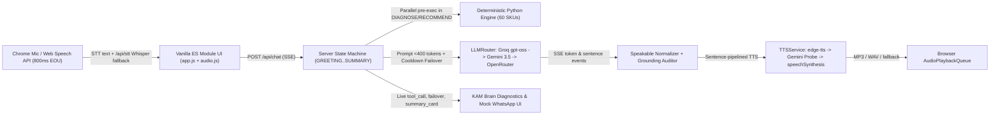

# Snapdeal Virtual KAM ("Riya") — Voice-First AI Key Account Manager

> **PROTOTYPE · MOCK DATA ONLY** — Simulated e-commerce marketplace Key Account Management agent built with 100% free APIs and zero credit card dependencies. Contains synthetic catalog/seller fixtures only (`Kumar Home & Kitchen`, Delhi, 60 SKUs).

[](https://www.python.org/) [](https://fastapi.tiangolo.com/) [](#)

---

## Why This Exists

Online marketplace sellers experiencing a sudden revenue drop don't want a passive FAQ chatbot—they need an attentive **Key Account Manager (KAM)** who listens by voice, pinpoints root causes with verified store numbers, drives concrete dated commitments, and holds an accountability follow-up call.

**Riya** solves a realistic scenario (**32.5% monthly sales decline**, `₹2,00,000 -> ₹1,35,000`) across three voice modes:
1. **Inbound Call:** Seller initiates call ("My sales dropped significantly this month...").
2. **Proactive Call:** Riya initiates outbound call alerting the seller to `18` out-of-stock SKUs.
3. **3-Day Follow-Up Simulation:** Closed-loop check-in reviewing prior commitments against improved `+30%` sales pace (`₹1,75,500`) and chasing remaining blockers (`HK-009`, `HK-021`).

Supports **English (India)**, **Hinglish**, and **Hindi (हिंदी)** with live language/voice switching, interruption handling (`Tap to Interrupt / Spacebar` + true `Headphones Mode` barge-in), and real-time **KAM Brain** transparency.

---

## Architecture Overview



### Key Reliability & Latency Engineering
- **Zero-Math LLM Policy:** 100% of metrics, driver attributions (`60% OOS / 20% Pricing / 20% Cancellations & Visibility`), and SKU numbers come from [`diagnosis.py`](app/engine/diagnosis.py). Every spoken reply runs through `find_ungrounded_numbers()` ([`speakable.py`](app/agent/speakable.py)) to guarantee **0 hallucinated figures**.
- **Pre-Executed `DIAGNOSE` & `RECOMMEND` Turns:** Server executes all 5 deterministic diagnosis tools concurrently in ~1–3 ms before calling the LLM, exposes **0 tools** during analysis turns (1 LLM request/turn), and streams every tool execution to the KAM Brain panel.
- **Verified Nov 2026 Free LLM Failover (`LLMRouter`):**
  - **Primary (Groq Free Tier):** `openai/gpt-oss-20b` -> `openai/gpt-oss-120b` (`llama-4-scout` removed per July 2026 deprecation; live `/models` check filters active models at boot; `reasoning_effort="low"` + `<think>` filter).
  - **Fallback 1 (Gemini Free Tier):** `gemini-3.5-flash-lite` -> `gemini-3.6-flash` via `google-genai` SDK preserving `thought_signature`.
  - **Fallback 2 (Optional OpenRouter Free):** `openrouter/free`.
  - **Per-Provider 429/403 Cooldown:** Rate-limited or blocked models enter cooldown automatically (`Retry-After` / 60s / 3600s on 403), skipping dead endpoints on subsequent turns with zero call drops.
- **Sub-2s Voice Pipeline:** `800ms` end-of-utterance timer, `600ms` conversational filler audio, streamed sentence chunking, and pipelined `N+1` `/api/tts` pre-fetching with LRU caching for repeated phrases.

---

## Quick Start (One Command Locally + Free Public HTTPS Tunnel)

> **Microphone access requires HTTPS** (except `http://localhost` / `http://127.0.0.1` in Chrome).  
> **Primary Live Demo Path:** Run locally + **Cloudflare Quick Tunnel** (`https://*.trycloudflare.com`) for zero cold start and guaranteed `edge-tts` neural voice output.

### 1. Prerequisites
- Python **3.12+** (or [`uv`](https://docs.astral.sh/uv/))
- **Google Chrome** (recommended for live Web Speech recognition; includes collapsible Debug Text Box for any browser)
- Free API keys (no credit card): [`GROQ_API_KEY`](https://console.groq.com/keys) and [`GEMINI_API_KEY`](https://aistudio.google.com/apikey)

### 2. Setup Environment & Install Dependencies
```powershell
git clone <your-repo-url>
cd snapdeal

# Create virtual environment and install pinned runtime dependencies
python -m venv .venv
# Windows: .\.venv\Scripts\activate  |  macOS/Linux: source .venv/bin/activate
pip install -r requirements.txt

# Configure API keys locally (.env is gitignored)
copy .env.example .env   # Linux/macOS: cp .env.example .env
```
Open `.env` and fill in your free keys:
```env
GROQ_API_KEY=gsk_...
GEMINI_API_KEY=AIza...
```

### 3. Run Locally + Cloudflare Quick Tunnel (Recommended Live Demo)
Optional: install `cloudflared` once on Windows if not present:
```powershell
winget install --id Cloudflare.Cloudflared -e
# OR standalone exe without admin rights:
curl.exe -L -o cloudflared.exe https://github.com/cloudflare/cloudflared/releases/latest/download/cloudflared-windows-amd64.exe
```
Start the server + public HTTPS URL in **one command**:
```powershell
# Windows PowerShell:
.\run.ps1

# Local HTTP only (no tunnel):
.\run.ps1 -LocalOnly

# macOS / Linux / Git Bash:
./run.sh
```
Open the printed **`https://*.trycloudflare.com`** URL (or **`http://127.0.0.1:7860`** locally) in **Google Chrome**, click **Start Call**, and allow microphone permission.

---

## Deploy Free to Render (`render.yaml`, Zero Credit Card)

Hugging Face Docker/Gradio Spaces now require a paid PRO plan, so our cloud hosting uses **Render Free Web Service**:
1. Push this repository to GitHub (`.env` is gitignored — never commit secrets).
2. Sign in to [Render](https://dashboard.render.com) with GitHub (**Free / Hobby plan requires no credit card**).
3. Click **New + -> Blueprint** (reads [`render.yaml`](render.yaml)) and select your repo.
4. Enter `GROQ_API_KEY` and `GEMINI_API_KEY` when prompted under Environment Variables.
5. Wait for build completion (~2 min) and verify your live deployment:
   ```bash
   python scripts/smoke_test.py --url https://<your-service>.onrender.com
   ```
   *(You can also check `GET /api/tts-probe` on the Render URL to verify whether Render's shared datacenter IPs allow `edge-tts` or trigger automatic browser `speechSynthesis` fallback.)*

### Docker (Generic Single-Container Run)
```bash
docker build -t snapdeal-virtual-kam .
docker run -p 7860:7860 --env-file .env -e PORT=7860 snapdeal-virtual-kam
```

---

## Deployment Limits & Free-Tier Trade-Offs

| Constraint | Details & Mitigation |
| :--- | :--- |
| **Render Free Sleep & RAM** | Free web instances sleep after **15 minutes of inactivity** (~45–60s cold start) and have **512 MB RAM**. Mitigated via `--workers 1`, tiny dependencies (`no Torch/Chromium` in `requirements.txt`), and warming `/api/health` before demos. Session state resets on container restart. |
| **Free LLM Rate Limits (RPM/TPM)** | Groq and Gemini free tiers enforce per-minute/per-day caps. Mitigated via compact `<400`-token system prompts, zero-tool pre-executed `DIAGNOSE` turns, low reasoning effort, and automatic cooldown failover across Groq -> Gemini -> OpenRouter. |
| **`edge-tts` Is Unofficial** | Microsoft Edge's TTS WebSocket occasionally blocks shared datacenter IPs (`403`/`503`). Handled gracefully via automatic failover to `window.speechSynthesis`, `/api/tts-probe` observability, and recommending **Local + Cloudflare Quick Tunnel** as primary live-demo path. |
| **Web Speech STT Browser Support** | `SpeechRecognition` works natively in Chrome/Edge desktop/Android; non-Chrome desktop browsers display a helpful notice and remain testable anytime via the **Debug Text Box** (plus `/api/stt` Groq Whisper fallback endpoint). |

---

## Testing & Verification

```powershell
# Run full test suite (Reconciliation, Diagnosis, LLM Failover/Cooldown, TTS/API, 4-Persona Scenarios, Playwright UI)
.\.venv\Scripts\pytest.exe -v

# Run HTTP/SSE/TTS smoke verification against running local or Render URL
.\.venv\Scripts\python.exe scripts/smoke_test.py --url http://127.0.0.1:7860
```

### Troubleshooting
- **Mic won't hear me / echoes Riya:** Keep **Headphones Mode** UNCHECKED when using laptop speakers; use **Tap to Interrupt (Space)** instead. Only enable **Headphones Mode** when wearing earphones.
- **Non-Chrome browser warning:** Switch to **Google Chrome** for live microphone voice input, or click **Debug Text Box** inside Call Settings to drive turns via text.
- **`AllProvidersUnavailableError` / rate limits:** Check `GET /api/health` to inspect `llm_startup_smoke` and cooldown states, verify valid `GROQ_API_KEY` / `GEMINI_API_KEY` in `.env`, or wait 60s for cooldown expiry.

---

## Additional Documentation
- [`docs/NOTE.md`](docs/NOTE.md) — 1-page architecture & assignment summary note
- [`docs/DEMO_SCRIPT.md`](docs/DEMO_SCRIPT.md) — Exact 90–120 second live walkthrough choreography
- [`docs/ASSUMPTIONS.md`](docs/ASSUMPTIONS.md) — Data definitions, 60-SKU reconciliation, recovery & operational assumptions
- [`docs/INTERVIEW_PREP.md`](docs/INTERVIEW_PREP.md) — Defensible Q&A for every architectural choice
- [`docs/SETUP_CHECKLIST.md`](docs/SETUP_CHECKLIST.md) — Step-by-step free API, Render & Cloudflare setup guide
