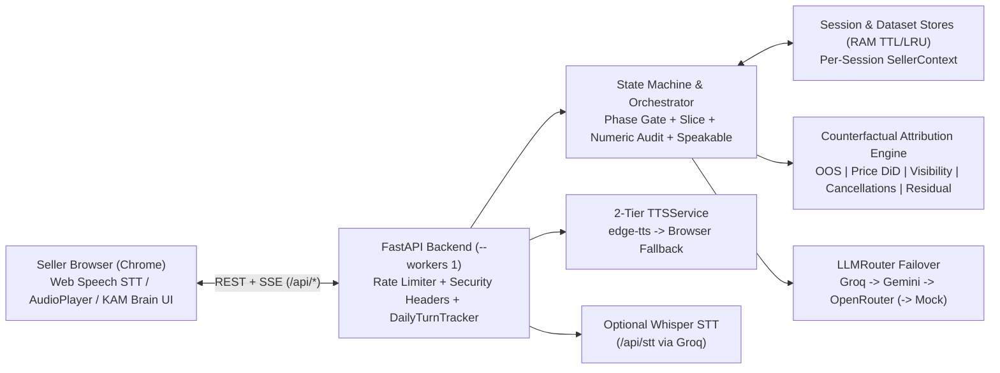

# VoiceKAM (`metis`) — Voice-First AI Key Account Manager

> **VoiceKAM Seller Intelligence SaaS. Not affiliated with any marketplace.**

**VoiceKAM** is a brand-neutral, open-source voice-first AI Key Account Manager (`metis`) for e-commerce seller retention and root-cause revenue diagnostics. Combining a deterministic server-controlled phase state machine, a counterfactual disjoint attribution engine (`stock_outs`, `pricing_gaps`, `visibility_drop`, `cancellations`, and explicit `unexplained_residual`), strict numeric grounding checks, multi-provider free-tier LLM failover, and natural Indian English / Hinglish / Hindi voice I/O, VoiceKAM runs interactive live voice calls on built-in synthetic scenarios or user-uploaded SKU CSV/JSON datasets without external paid dependencies.

---

## Key Features

- **Server-Owned Voice State Machine:** Predictable call lifecycle (`GREETING -> UNDERSTAND -> CLARIFY -> DIAGNOSE -> RECOMMEND -> COMMIT -> SUMMARY -> CLOSE`, plus proactive and 3-day `followup` paths) with strict per-phase tool gating (`tools_for_phase`).
- **Counterfactual Disjoint Attribution Engine:** Computes lost orders and lost GMV directly from SKU, visibility funnel, and cancellation records without double-counting, isolating ambient store-wide trends via an in-stock fairly-priced control cohort (`docs/ATTRIBUTION.md`).
- **Post-Generation Numeric Grounding Audit:** Pre-executes diagnostic tools before diagnosis/recommendation turns, collects all grounded tool numbers per session, and audits every spoken reply (`find_ungrounded_numbers`), logging any ungrounded digit sequence in `latency` telemetry.
- **Custom CSV / JSON Upload Validation:** Upload synthetic or anonymized SKU tables (`POST /api/data/validate` & `/api/session/start`) held strictly in RAM with formula-injection blocking, HTML stripping, TTL expiration, and `"not assessable with the data provided"` graceful degradation ([docs/DATA_SCHEMA.md](docs/DATA_SCHEMA.md)).
- **Multilingual Indian Voice UX:** Seamless `en-IN`, `hinglish`, and `hi-IN` speakable normalization (`int_to_indian_english`, `int_to_indian_hindi`), Chrome Web Speech API + 800 ms end-of-utterance detection, echo guard, barge-in toggle, optional Groq Whisper `/api/stt`, and 2-tier TTS (`edge-tts` -> browser `speechSynthesis`).
- **Free-Tier Resilience & Quota Protection:** Automatic `LLMRouter` failover across Groq (verified live via `/models`), Google Gemini, and OpenRouter with HTTP `429` cooldowns, HTTP `403` permanent disablement, per-IP sliding-window rate limiting, and `DAILY_TURN_CAP`.
- **Single-Source Branding Config:** Change `PROJECT_NAME`, `AGENT_NAME`, and `AGENT_NAME_DEVANAGARI` in one place (`app/config.py`) to rebrand backend prompts, greetings, health endpoints, and frontend UI dynamically.

---

## Architecture Overview



See [docs/ARCHITECTURE.md](docs/ARCHITECTURE.md) and [docs/DECISIONS.md](docs/DECISIONS.md) for detailed component design and Architecture Decision Records.

---

## Quick Start

### 1. Local Development (Offline Mock Mode — Zero API Keys Needed)

**Windows (PowerShell):**
```powershell
python -m venv .venv
.\.venv\Scripts\python.exe -m pip install -r requirements.txt
$env:ALLOW_MOCK_LLM = "true"
$env:TTS_PROVIDER = "browser"
.\.venv\Scripts\python.exe -m uvicorn app.main:app --host 127.0.0.1 --port 7860 --workers 1
```

**macOS / Linux:**
```bash
python3 -m venv .venv && source .venv/bin/activate
pip install -r requirements.txt
ALLOW_MOCK_LLM=true TTS_PROVIDER=browser uvicorn app.main:app --host 127.0.0.1 --port 7860 --workers 1
```

Open `http://127.0.0.1:7860` in Google Chrome.

### 2. Local Development with Free LLM Keys + Public HTTPS Tunnel

Copy `.env.example` to `.env`, add `GROQ_API_KEY` and/or `GEMINI_API_KEY`, then launch server + Cloudflare Quick Tunnel:
- **Windows:** `.\run.ps1` (or `.\run.ps1 -LocalOnly` without tunnel)
- **macOS / Linux:** `./run.sh` (or `make run`)

### 3. Docker

```bash
docker build -t voicekam .
docker run --rm -p 7860:7860 --env-file .env voicekam
```

### 4. Render Free Tier (`$0 / mo`)

Use [render.yaml](render.yaml) via Render **New + -> Blueprint** (Python 3.12, `plan: free`, single worker `--workers 1`) and set `GROQ_API_KEY` / `GEMINI_API_KEY` in Render Environment Variables. Verify deployment with:
```bash
python scripts/smoke_test.py --url https://<your-service>.onrender.com
```

---

## Environment Configuration

All settings load via `app/config.py` (`Settings` / `.env`):

| Variable | Default | Purpose |
| :--- | :--- | :--- |
| `PROJECT_NAME` | `VoiceKAM` | Project title returned by `/api/health` and hydrated across UI |
| `AGENT_NAME` | `metis` | Persona name used in prompts, greetings, warmups, and UI |
| `AGENT_NAME_DEVANAGARI` | `metis` | Agent spelling rendered in `hi-IN` prompts and greetings |
| `AGENT_NAME_SPOKEN_EN` | `metis` | Optional TTS-only pronunciation for `en-IN`/`hinglish` without changing UI text |
| `AGENT_NAME_SPOKEN_HI` | `metis` | Optional TTS-only pronunciation for `hi-IN` without changing UI text |
| `GROQ_API_KEY` | `""` | Primary free-tier Groq key (LLM + optional `/api/stt` Whisper) |
| `GROQ_MODELS` | `openai/gpt-oss-20b,openai/gpt-oss-120b,qwen/qwen3.6-27b,qwen/qwen3.8-27b` | Ordered Groq model chain filtered live via `/models` |
| `GROQ_REASONING_EFFORT` | `low` | Reasoning effort parameter passed to Groq reasoning models |
| `GEMINI_API_KEY` | `""` | Fallback Google Gemini key (LLM) |
| `GEMINI_MODELS` | `gemini-3.5-flash-lite,gemini-3.6-flash` | Ordered Gemini fallback chain |
| `OPENROUTER_API_KEY` | `""` | Optional 3rd-tier OpenRouter API key |
| `OPENROUTER_MODEL` | `openrouter/free` | OpenRouter fallback model identifier |
| `PROVIDER_COOLDOWN_SECONDS` | `60` | Cooldown window placed on providers returning HTTP `429` |
| `GROQ_WHISPER_MODEL` | `whisper-large-v3-turbo` | Whisper model used by `/api/stt` when Groq key is present |
| `TTS_PROVIDER` | `auto` | Voice output chain (`auto`, `edge-tts`, `browser`) |
| `TTS_VOICE_EN` / `TTS_VOICE_HI` | `en-IN-NeerjaNeural` / `hi-IN-SwaraNeural` | Microsoft Edge neural voices for `en-IN`/`hinglish` and `hi-IN` |
| `TTS_CACHE_ENABLED` | `true` | Enables RAM LRU audio cache (up to 200 entries) |
| `PORT` / `LLM_TIMEOUT_SECONDS` | `7860` / `12.0` | HTTP listen port and per-provider streaming timeout |
| `ALLOW_MOCK_LLM` | `false` | Enables deterministic in-process `MockLLMProvider` for offline CI |
| `ENABLE_GEMINI_LIVE` | `false` | Reserved experimental flag (off by default) |
| `MAX_UPLOAD_SKUS` / `MAX_UPLOAD_BYTES` | `2000` / `1048576` | Custom CSV/JSON row count and upload size caps (1 MB) |
| `MAX_REQUEST_BYTES` | `2097152` | Global HTTP request body cap (`Content-Length` > 2 MB -> HTTP 413) |
| `SESSION_TTL_SECONDS` / `MAX_SESSIONS` | `7200` / `200` | In-memory session and upload TTL (2h) + LRU capacity |
| `CORS_ORIGINS` | `*` | Comma-separated allowed CORS origins or `*` |
| `DAILY_TURN_CAP` | `400` | Global UTC daily `/api/chat` turn cap (emits friendly SSE error) |
| `RATE_LIMIT_CHAT_PER_10M` | `30` | Per-IP `/api/chat` + `/greeting` limit per 10 minutes (`429`) |
| `RATE_LIMIT_TTS_PER_10M` | `120` | Per-IP `/api/tts` + `/tts-probe` limit per 10 minutes (`429`) |
| `RATE_LIMIT_STT_PER_10M` | `30` | Per-IP `/api/stt` limit per 10 minutes (`429`) |
| `RATE_LIMIT_STARTS_PER_HOUR` | `20` | Per-IP `/api/session/start` + `/api/data/validate` limit per hour (`429`) |

---

## Built-In Synthetic Demo Scenarios

| ID | Store Profile (City, SKUs) | Baseline -> Current GMV | Orders | Dominant Causal Driver | 3-Day Follow-Up Pace |
| :---: | :--- | :--- | :---: | :--- | :--- |
| **A** | **UrbanStride Footwear & Apparel** (`Vikram ji`, Bengaluru, 48 SKUs) | `₹4,75,190 -> ₹3,43,370` (`-27.7%`) | `476 -> 354` | Stock-outs (`57.4%`, `70` lost orders) | `₹3,94,336` (`+14.8%` vs crisis) |
| **B** | **TechNest Accessories** (`Neha ji`, Mumbai, 42 SKUs) | `₹2,69,600 -> ₹2,00,490` (`-25.6%`) | `437 -> 327` | Competitor Price Gaps (`41.8%`) & Visibility (`34.5%`) | `₹2,22,954` (`+11.2%` vs crisis) |
| **C** | **FreshBrew Pantry** (`Rohan ji`, Pune, 36 SKUs) | `₹1,26,950 -> ₹89,620` (`-29.4%`) | `360 -> 251` | Seller-Caused Cancellations & SLA (`60.6%`) | `₹92,954` (`+3.7%` vs crisis) |
| **D** | **ArtisanCraft Decor** (`Meenakshi ji`, Jaipur, 40 SKUs) | `₹5,35,200 -> ₹3,93,080` (`-26.6%`) | `400 -> 296` | Mixed causes + Unexplained Residual (`28.8%`) | `₹4,34,311` (`+10.5%` vs crisis) |

Want to test your own dataset? Download CSV/JSON templates directly from the UI (**"Use my own data"**) or `GET /api/data/template?format=csv` following [docs/DATA_SCHEMA.md](docs/DATA_SCHEMA.md).

---

## Evaluation Summary

Metrics below are taken directly from [docs/EVALUATION.md](docs/EVALUATION.md), with **Live** and **Offline Mock** runs kept strictly separate.

### Live Evaluation (`Live`: `48` Attempted / `45` Succeeded Calls, `N = 2`)

Measured across `6` scripted seller personas × `4` seeded scenarios × `2` runs using `LLMRouter` failover (`groq:openai/gpt-oss-20b`, `groq:openai/gpt-oss-120b`, `gemini:gemini-3.5-flash-lite`, `gemini:gemini-3.6-flash`), real `edge-tts` MP3 synthesis timing, and cross-model LLM-as-judge (`3` calls failed on a multi-turn Gemini tool-slice edge case):

| Metric (Live) | Measured Value | Detail |
| :--- | :--- | :--- |
| Grounding rate (turns) | `100.0%` | `292/292` completed turns with `0` ungrounded numbers |
| Grounding rate (number tokens) | `100.0%` | `604/604` spoken numeric tokens traced to tools |
| Expected tool-call accuracy | `100.0%` | `360/360` expected phase tools executed |
| Phase completion rate | `93.8%` | `45/48` attempted calls reached `SUMMARY`/`CLOSE` with summary card |
| Words per turn (avg / max) | `32.3` / `56` | Voice budget (`45` default, `55` `DIAGNOSE`/`RECOMMEND`, `82` `SUMMARY`) |
| Commitments captured | `93.8%` (`45` total) | `45/48` calls captured `>=1` commitment |
| LLM first-token latency (p50 / p95) | `2004.0 ms` / `5840.0 ms` | End-to-end across `292` live turns (includes rate-limit failover hops) |
| First-audio latency (p50 / p95) | `3969.0 ms` / `7966.0 ms` | Turn start -> first `sentence` + `edge-tts` MP3 ready (`284` turns measured) |
| Cross-model LLM-as-judge (1–5) | `4.6 / 5.0` | `n=43/48` (`rel 4.72`, `emp 4.24`, `clr 4.69`, `act 4.74`, `unc 4.6`) |

### Offline Mock Baseline (`Offline Mock`: `24/24` Calls, `N = 1`)

Run hermetically via `MockLLMProvider` (`156` assistant turns): **`100.0%`** turn & token grounding (`348/348`), **`100.0%`** tool accuracy (`192/192`), **`100.0%`** completion (`24/24`), **`23.5` / `34`** avg/max words, and `1.0 ms` / `3.0 ms` in-process first-token timing (`first_audio_ms` and judge score reported as `not measured`).

### Synthetic Causal-Recovery Check

`test_200_seeded_trials_ground_truth_recovery` ([tests/test_attribution_properties.py](tests/test_attribution_properties.py)) achieves **`200/200` top-driver recovery** (`0.02 pp` mean absolute error, `8.3 pp` max error) **strictly on synthetic ground truth generated by the project's own scenario generator (`app/data/scenarios.py`)** — not a claim about real-world marketplace causal accuracy.

---

## Testing, Privacy & Documentation Map

- **Run Test Suite:** `pytest -k "not live_llm" -v` (or see [Makefile](Makefile) for `eval`, `eval-live`, `smoke`).
- **Clean Historyless Export:** `.\scripts\export_clean_repo.ps1` (Windows) or `./scripts/export_clean_repo.sh` (Unix).
- **Documentation Index:**
  - [docs/ARCHITECTURE.md](docs/ARCHITECTURE.md) — State machine, pre-execution, grounding checker, LLM router, and audio pipeline
  - [docs/ATTRIBUTION.md](docs/ATTRIBUTION.md) — Exact causal attribution equations & reconciliation proofs
  - [docs/DATA_SCHEMA.md](docs/DATA_SCHEMA.md) — Custom CSV/JSON upload specification & graceful degradation rules
  - [docs/API_CONTRACT.md](docs/API_CONTRACT.md) — `v1` REST and SSE event catalog
  - [docs/EVALUATION.md](docs/EVALUATION.md) — Evaluation methodology and per-scenario/per-persona breakdown
  - [docs/PRIVACY.md](docs/PRIVACY.md) — RAM-only data handling and external LLM safety notice
  - [docs/DECISIONS.md](docs/DECISIONS.md) | [docs/RELATED_WORK.md](docs/RELATED_WORK.md) | [docs/DEMO_SCRIPT.md](docs/DEMO_SCRIPT.md) | [docs/PROJECT_SUMMARY.md](docs/PROJECT_SUMMARY.md)

---

## Known Limitations & Roadmap

- **Synthetic Scope:** Built-in stores A–D are purely synthetic; custom CSV uploads require at least 5 core SKU columns and mark missing signal groups `"not assessable with the data provided"`.
- **Single-Worker In-Memory State:** `SessionStore`, `UploadedDatasetStore`, `TTSService` cache, and rate limiters reside in process RAM, requiring `--workers 1` cleanly suited for single-instance demos (Redis adapter is future work for multi-replica scaling).
- **Datacenter TTS Throttling:** Free cloud egress IPs may intermittently throttle Microsoft Edge TTS; VoiceKAM automatically drops to client `window.speechSynthesis` (and runs at full neural quality over local Cloudflare Tunnel).
- **Privacy Notice:** Do **not** upload real or confidential merchant data — active sessions send compact aggregated tool outputs to configured free-tier external LLM APIs ([docs/PRIVACY.md](docs/PRIVACY.md)).
- **License:** Released under the [MIT License](LICENSE).
