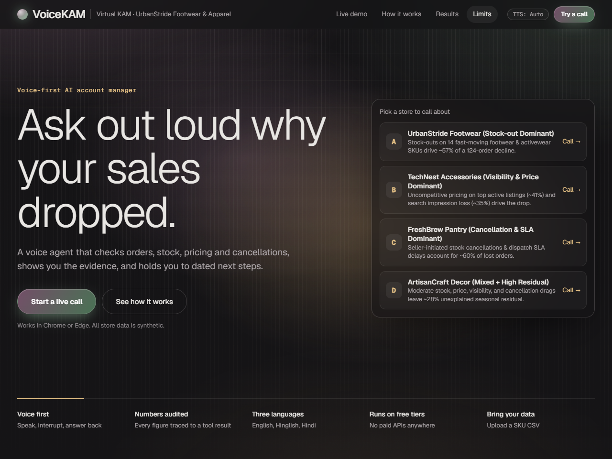
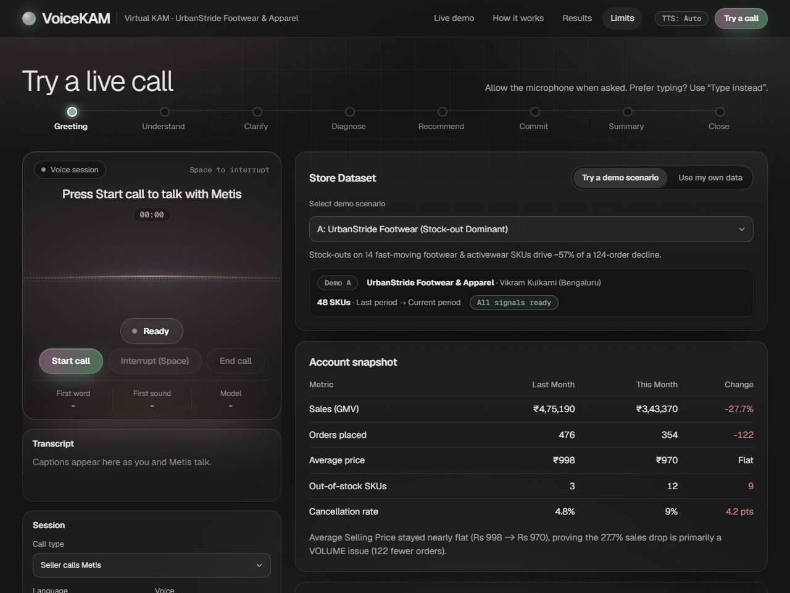
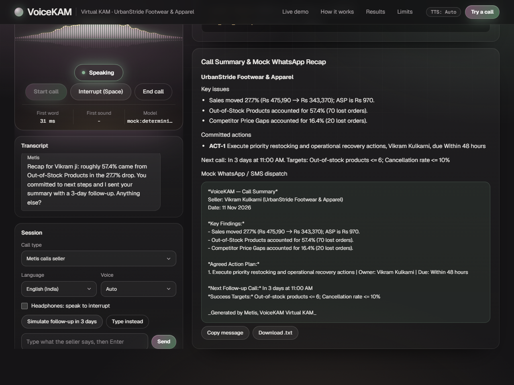
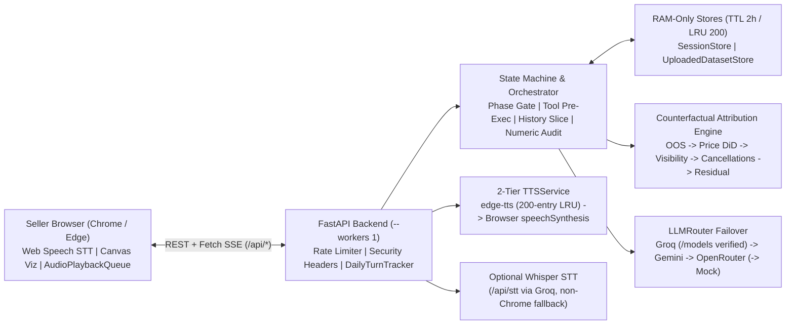

<div align="center">

# VoiceKAM (`Metis`)

**Voice-first AI Key Account Manager for e-commerce seller revenue diagnostics and operational accountability**

Open-source prototype pairing a server-owned conversation state machine, sequential counterfactual revenue-drop attribution, and real-time numeric grounding checks with multilingual Indian English, Hinglish, and Hindi voice interaction on free-tier inference APIs.

[](pyproject.toml)
[](requirements.txt)
[](requirements.txt)
[](LICENSE)
(https://github.com/dummycodertech/VoiceKAM/actions/workflows/tests.yml)
[](https://snapdeal-virtual-kam.onrender.com)

[**Live Demo**](https://snapdeal-virtual-kam.onrender.com) · [**UI Gallery**](#interface-gallery) · [**Architecture**](#architecture-and-methodology) · [**Attribution Math**](docs/ATTRIBUTION.md) · [**Quick Start**](#getting-started) · [**API Contract**](docs/API_CONTRACT.md) · [**Evaluation**](docs/EVALUATION.md)

</div>

> [!NOTE]
> **Prototype Scope:** Built-in stores (`A`–`D`) are 100% synthetic data ([docs/ASSUMPTIONS.md](docs/ASSUMPTIONS.md)), and VoiceKAM is not affiliated with any marketplace. Do **not** upload confidential merchant data; active calls send compact aggregated tool summaries to configured external LLM tiers ([docs/PRIVACY.md](docs/PRIVACY.md)). Hosted on Render's free tier (`plan: free`), so the first request after idle sleep takes roughly a minute to wake.

---

## Contents

- [Project at a Glance](#project-at-a-glance)
- [Interface Gallery](#interface-gallery)
- [How VoiceKAM Works](#how-voicekam-works)
- [Architecture and Methodology](#architecture-and-methodology)
- [Getting Started](#getting-started)
- [Usage and Configuration](#usage-and-configuration)
- [Built-In Synthetic Scenarios](#built-in-synthetic-scenarios)
- [Results and Evaluation](#results-and-evaluation)
- [Repository Layout](#repository-layout)
- [Testing and CI](#testing-and-ci)
- [Deployment](#deployment)
- [Design Decisions and Trade-offs](#design-decisions-and-trade-offs)
- [Roadmap and Future Scope](#roadmap-and-future-scope)
- [Contributing, Security and License](#contributing-security-and-license)

---

## Project at a Glance

| Dimension | Implementation in Repository |
| :--- | :--- |
| **Live Hosted Instance** | [https://snapdeal-virtual-kam.onrender.com](https://snapdeal-virtual-kam.onrender.com) (Render `plan: free`, single worker `--workers 1`) |
| **Runtime Stack** | Python 3.12 (`>=3.11`), FastAPI (`>=0.115.0`), Uvicorn (`>=0.32.0`), Pydantic v2 (`>=2.9.0`), zero build-step ES module frontend |
| **LLM Failover Chain** | `Groq` (filtered live via `/models`) -> `Google Gemini` (`google-genai`) -> `OpenRouter` (optional) -> `MockLLMProvider` (`ALLOW_MOCK_LLM=true` only) |
| **Voice Pipeline** | Chrome/Edge Web Speech API (`800 ms` EOU debounce + echo guard + barge-in) -> optional Groq Whisper `/api/stt`; 2-tier TTS (`edge-tts` -> browser `speechSynthesis`) |
| **Domain Scenarios** | 4 seeded synthetic stores (`A`–`D`) + RAM-only CSV/JSON custom uploads (`MAX_UPLOAD_SKUS=2000`, `1 MB` cap) |
| **Verified Test Suite** | 57 offline hermetic tests + 1 opt-in `live_llm` test in CI ([.github/workflows/tests.yml](.github/workflows/tests.yml)) + offline eval CLI ([scripts/run_eval.py](scripts/run_eval.py)) |
| **Maintainer & License** | [`@dummycodertech`](https://github.com/dummycodertech) · [MIT License](LICENSE) |

---

## Interface Gallery

<table>
  <tr>
    <td width="50%" align="center">
      <a href="docs/media/hero-desktop.png"></a><br/>
      <sub><b>Landing Hero (1280px):</b> Interactive store scenario cards (<code>A</code>–<code>D</code>) hydrated from <code>GET /api/scenarios</code> with direct jump-to-call selection.</sub>
    </td>
    <td width="50%" align="center">
      <a href="docs/media/demo-stage.png"></a><br/>
      <sub><b>Interactive Call Stage (1280px):</b> Sticky voice control card, phase progress bar (<code>#phaseStrip</code>), Scenario/CSV switcher, and baseline account snapshot.</sub>
    </td>
  </tr>
  <tr>
    <td width="50%" align="center">
      <a href="docs/media/call-summary.png"></a><br/>
      <sub><b>Active Call &amp; Summary Card (1280px):</b> Live canvas audio waveform, streaming transcript, <code>MockLLMProvider</code> telemetry, locked commitments, and copy/download WhatsApp recap.</sub>
    </td>
    <td width="50%" align="center">
      <a href="docs/media/hero-mobile.png"></a><br/>
      <sub><b>Responsive Mobile View (390px):</b> Stacked hero, scenario picker cards, and single-column call layout tested with zero horizontal overflow.</sub>
    </td>
  </tr>
</table>

---

## How VoiceKAM Works

Small and mid-sized online sellers often experience sudden week-over-week revenue drops without an analyst to isolate *how much* of the decline came from out-of-stock bestsellers versus uncompetitive pricing, lost search impressions, or seller-side cancellations. General-purpose chatbots tend to guess percentages, perform faulty arithmetic inline, or drift off script without securing dated corrective actions.

**VoiceKAM solves this by decoupling calculation from conversation:**

1. **Deterministic Computation Before Speech:** All GMV deltas, daily-velocity stock-out estimates, control-group price comparisons, net impression funnels, and cancellation counts live strictly in [app/engine/diagnosis.py](app/engine/diagnosis.py). The language model **never computes metrics** or accesses synthetic ground-truth generator labels (`driver_group`).
2. **Server-Owned State & Tool Pre-Execution:** [app/agent/state_machine.py](app/agent/state_machine.py) and [app/agent/orchestrator.py](app/agent/orchestrator.py) drive phase progression (`GREETING` -> `UNDERSTAND` -> `CLARIFY` -> `DIAGNOSE` -> `RECOMMEND` -> `COMMIT` -> `SUMMARY` -> `CLOSE`, plus proactive and 3-day `followup` paths). Before `DIAGNOSE`, `REVIEW_COMMITMENTS`, or `RECOMMEND` turns hit an LLM, the server runs the required Python tools concurrently via `asyncio.gather` and injects compact tool outputs into the prompt.
3. **Live Numeric Grounding Audit:** Every tool response populates `session.grounded_numbers`. After generating a reply, `find_ungrounded_numbers()` checks every numeric token spoken by the LLM (masking catalog SKU IDs, durations, and ordinals) and logs ungrounded tokens directly into SSE telemetry (`latency.ungrounded_numbers`) and the KAM Brain verification pill.
4. **Honesty Under Missing Data:** Uploading a CSV with only the 5 required columns (`sku_id, name, price, orders_prev, orders_curr`) marks unprovided signals as `"not assessable with the data provided"` and retains unattributed variance transparently inside `unexplained_residual` rather than fabricating breakdowns.

---

## Architecture and Methodology



### Core Components

- **Counterfactual Disjoint Attribution ([app/engine/diagnosis.py](app/engine/diagnosis.py), [docs/ATTRIBUTION.md](docs/ATTRIBUTION.md)):**
  - **Stock-Outs (`stock_outs`):** `velocity * days_out_of_stock_curr` capped by each SKU's observed order decline (falls back cleanly to `stock_qty_curr <= 0` when days are omitted).
  - **Competitor Price Gaps (`pricing_gaps`):** In-stock SKUs priced `> 3%` above `competitor_lowest_price`, compared against an in-stock, fairly-priced control cohort's median order change (`ambient_trend`) so store-wide demand shifts are not misattributed to pricing. Strictly disjoint from out-of-stock SKUs.
  - **Search Visibility (`visibility_drop`):** Impression decline multiplied by baseline orders per impression, bounded by each SKU's *remaining* unattributed order budget (`d_i`), automatically netting out losses already explained by stock-outs or pricing.
  - **Seller-Fault Cancellations (`cancellations`):** Net increase across seller-attributable cancellation rows (`is_seller_fault` or keywords `stock`, `dispatch`, `sla`, `seller`, `fulfill`, `warehouse`, `inventory`, `pack`).
  - **Unexplained Residual (`unexplained_residual`):** Guarantees exact additive reconciliation across all scenarios, custom uploads, and follow-up projections: `sum(driver.lost_orders) == total_lost_orders` and `sum(driver.lost_revenue) == total_lost_revenue`.
- **Voice Pacing & Speakable Normalization ([app/agent/speakable.py](app/agent/speakable.py)):** Converts `₹1,31,820`, `57.4%`, `US-001`, `->`, and marketplace abbreviations into spoken Indian English (`en-IN`, *lakh*/*crore*), Hinglish, or Devanagari Hindi (`hi-IN`, `लाख`/`हज़ार`, `प्रतिशत`, `रुपये`) sentence by sentence (`sentence` SSE events) while capping replies to voice-friendly budgets (`45` default words, `55` in `DIAGNOSE`/`RECOMMEND`, `82` in `SUMMARY`).

<details>
<summary>Deep Dive: Phase Gating, Failover Semantics & Security Controls</summary>

1. **Compact Phase-Gated Tooling (`tools_for_phase()`):** Exposes `0` callable tool schemas during `GREETING`, `UNDERSTAND`, `DIAGNOSE`, `REVIEW_COMMITMENTS`, `RECOMMEND`, and `CLOSE`; exposes at most `2` schemas in `CLARIFY` (`get_seller_overview`, `get_metric_comparison`), `COMMIT` (`commit_action`, `schedule_followup`), and `SUMMARY` (`send_call_summary`, `schedule_followup`). If the LLM skips `send_call_summary` during `SUMMARY`, the orchestrator synthesizes the summary card via `server_fallback`.
2. **Gemini 3.x & Multi-Provider History Repair:** `slice_recent_messages()` prevents trailing conversation windows (`~10` messages) from starting on orphaned `role="tool"` entries or incomplete `assistant(tool_calls)` pairs. `_canonical_to_gemini()` folds unsigned non-Gemini tool calls into plain text and inserts preceding user context when needed, preventing HTTP `400 INVALID_ARGUMENT` errors during mid-call failovers.
3. **Failure & Rate-Limit Resilience:** `LLMRouter` cools down HTTP `429` providers (`Retry-After` or `PROVIDER_COOLDOWN_SECONDS`), permanently disables HTTP `403` models for the process lifetime, streams sanitized `failover` SSE events (`{type, from, to, reason_code}` without leaking keys or upstream JSON), and enforces `DAILY_TURN_CAP`, per-IP sliding-window limits (`X-Forwarded-For` first hop), `MAX_REQUEST_BYTES` (`413`), formula-injection prefix blocking (`= + - @ \t \r`), HTML stripping, and `/api/health` secret scrubbing.
4. **Central Single-Source Branding ([app/config.py](app/config.py)):** Changing `PROJECT_NAME`, `AGENT_NAME`, `AGENT_NAME_DEVANAGARI`, `AGENT_NAME_SPOKEN_EN`, or `AGENT_NAME_SPOKEN_HI` propagates dynamically to backend system prompts, greetings, TTS probes, and `/api/health` UI hydration (`tests/test_debranding.py`).

</details>

---

## Getting Started

### Prerequisites

- **Python:** `3.11+` (`3.12` verified in CI, Docker, and Render)
- **Browser for Live Mic Input:** Google Chrome or Microsoft Edge (Web Speech API); other browsers automatically show the **"Type instead"** debug input bar and optional `/api/stt` Groq Whisper support.
- **API Keys (optional for offline mode):** Free-tier keys from [Groq](https://console.groq.com/keys) and/or [Google AI Studio](https://aistudio.google.com/apikey), plus optional [OpenRouter](https://openrouter.ai/keys).

### 1. Run Locally Without API Keys (`MockLLMProvider` + Browser TTS)

**Windows (PowerShell):**
```powershell
python -m venv .venv
.\.venv\Scripts\python.exe -m pip install -r requirements.txt
$env:ALLOW_MOCK_LLM = "true"
$env:TTS_PROVIDER = "browser"
.\.venv\Scripts\python.exe -m uvicorn app.main:app --host 127.0.0.1 --port 7860 --workers 1
```

**macOS / Linux:**
```bash
python3 -m venv .venv && source .venv/bin/activate
pip install -r requirements.txt
ALLOW_MOCK_LLM=true TTS_PROVIDER=browser uvicorn app.main:app --host 127.0.0.1 --port 7860 --workers 1
```

Open `http://127.0.0.1:7860` in Chrome or Edge. Pick any store card (`A`–`D`) or switch to **"Use my own data"**, click **Start call**, and click **Type instead** (or speak when using Chrome) to run an entire diagnostic call.

### 2. Run Locally With Live Free-Tier LLMs + Neural Voice + Cloudflare Tunnel

```powershell
Copy-Item .env.example .env    # macOS/Linux: cp .env.example .env
# Edit .env and add GROQ_API_KEY and/or GEMINI_API_KEY
.\run.ps1                       # Local only: .\run.ps1 -LocalOnly
```
```bash
./run.sh                        # Local only: ./run.sh --local (or make run)
```

### 3. Run With Docker

```bash
docker build -t voicekam .
docker run --rm -p 7860:7860 --env-file .env voicekam
```

### 4. Minimal Interactive SSE / REST Smoke Call

```bash
# Start a session against Scenario B (returns session_id and baseline demo_data)
curl -s -X POST http://127.0.0.1:7860/api/session/start \
  -H "Content-Type: application/json" \
  -d '{"mode":"proactive","language":"en-IN","scenario_id":"B"}'
```

---

## Usage and Configuration

### Custom Dataset Upload (`CSV` / `JSON`)

Under **Store Dataset -> Use my own data**, upload synthetic or anonymized SKU tables in RAM (up to `2,000` SKUs / `1 MB`):

- Downloadable templates from UI or API:
  - `GET /api/data/template?format=csv`
  - `GET /api/data/template?format=cancellations_csv`
  - `GET /api/data/template?format=json`
- **Minimum required SKU columns:** `sku_id`, `name`, `price`, `orders_prev`, `orders_curr`.
- **Optional SKU columns:** `category`, `competitor_lowest_price`, `days_out_of_stock_curr`, `days_out_of_stock_prev`, `stock_qty_curr`, `impressions_prev`, `impressions_curr`, `clicks_prev`, `clicks_curr`.
- Full upload schema, formula-safety checks, and missing-column behavior are specified in [docs/DATA_SCHEMA.md](docs/DATA_SCHEMA.md).

### Environment Variables ([app/config.py](app/config.py) & [.env.example](.env.example))

<details>
<summary>Complete Environment Reference (33 Variables Across Branding, LLM Chain, Speech & Quotas)</summary>

| Variable | Default | Purpose |
| :--- | :--- | :--- |
| `PROJECT_NAME` | `VoiceKAM` | Project title returned by `/api/health` and hydrated in UI |
| `AGENT_NAME` | `Metis` | Display and prompt persona name |
| `AGENT_NAME_DEVANAGARI` | `Metis` | Agent spelling used inside `hi-IN` prompts and greetings |
| `AGENT_NAME_SPOKEN_EN` / `_HI` | `Metis` / `Metis` | Optional TTS-only pronunciation overrides without altering display captions |
| `GROQ_API_KEY` | `""` | Primary Groq API key (LLM + optional `/api/stt` Whisper) |
| `GROQ_MODELS` | `openai/gpt-oss-20b,openai/gpt-oss-120b,qwen/qwen3.6-27b,qwen/qwen3.8-27b` | Ordered Groq models filtered at startup against live `/models` |
| `GROQ_REASONING_EFFORT` | `low` | Reasoning effort parameter passed to Groq reasoning models |
| `GEMINI_API_KEY` | `""` | Fallback Google Gemini AI Studio key |
| `GEMINI_MODELS` | `gemini-3.5-flash-lite,gemini-3.6-flash` | Ordered Gemini fallback model chain |
| `OPENROUTER_API_KEY` | `""` | Optional 3rd-tier OpenRouter API key |
| `OPENROUTER_MODEL` | `openrouter/free` | OpenRouter fallback model identifier |
| `PROVIDER_COOLDOWN_SECONDS` | `60` | Temporary cooldown applied after HTTP `429` responses |
| `GROQ_WHISPER_MODEL` | `whisper-large-v3-turbo` | Model used by `/api/stt` audio transcription |
| `TTS_PROVIDER` | `auto` | Output audio mode: `auto` (`edge-tts` -> `browser`), `edge-tts`, or `browser` |
| `TTS_VOICE_EN` / `TTS_VOICE_HI` | `en-IN-NeerjaNeural` / `hi-IN-SwaraNeural` | Microsoft Edge Neural voices for `en-IN`/`hinglish` and `hi-IN` |
| `TTS_CACHE_ENABLED` | `true` | Enables 200-entry RAM LRU audio cache in `TTSService` |
| `LLM_TIMEOUT_SECONDS` | `12.0` | Per-provider streaming timeout in `LLMRouter` (`openrouter` uses `>=15.0`) |
| `PORT` | `7860` | Server port read by `run.ps1`, `run.sh`, `Makefile`, Docker, and Render |
| `ALLOW_MOCK_LLM` | `false` | Appends deterministic `MockLLMProvider` for offline CI & local demos |
| `SESSION_TTL_SECONDS` / `MAX_SESSIONS` | `7200` / `200` | In-memory TTL (2 hours) and LRU cap for sessions and uploaded datasets |
| `MAX_UPLOAD_SKUS` / `MAX_UPLOAD_BYTES` | `2000` / `1048576` | CSV/JSON row count cap and `1 MB` payload cap |
| `MAX_REQUEST_BYTES` | `2097152` | Global HTTP request size guard (`2 MB` -> HTTP `413`) |
| `CORS_ORIGINS` | `*` | Comma-separated allowed CORS origins or `*` |
| `DAILY_TURN_CAP` | `400` | Global UTC daily `/api/chat` LLM turn cap |
| `RATE_LIMIT_CHAT_PER_10M` | `30` | Per-IP `/api/chat` and `/greeting` limit per 10-minute window |
| `RATE_LIMIT_TTS_PER_10M` | `120` | Per-IP `/api/tts` and `/tts-probe` limit per 10-minute window |
| `RATE_LIMIT_STT_PER_10M` | `30` | Per-IP `/api/stt` limit per 10-minute window |
| `RATE_LIMIT_STARTS_PER_HOUR` | `20` | Per-IP `/api/session/start` and `/api/data/validate` hourly limit |

</details>

---

## Built-In Synthetic Scenarios

All four stores below are generated deterministically by [app/data/scenarios.py](app/data/scenarios.py) and summarized identically in the UI and REST API:

| ID | Store Profile (City, SKUs) | Baseline -> Current GMV | Orders | Primary Computed Driver (Disjoint Share) | 3-Day Follow-Up Pace |
| :---: | :--- | :--- | :---: | :--- | :--- |
| **A** | **UrbanStride Footwear & Apparel** (`Vikram ji`, Bengaluru, 48 SKUs) | `₹4,75,190 -> ₹3,43,370` (`-27.7%`) | `476 -> 354` | Stock-outs: `57.4%` (`70` lost orders) | `₹3,94,336` (`+14.8%` vs crisis) |
| **B** | **TechNest Accessories** (`Neha ji`, Mumbai, 42 SKUs) | `₹2,69,600 -> ₹2,00,490` (`-25.6%`) | `437 -> 327` | Competitor price gaps: `41.8%` (`46`) + visibility: `34.5%` (`38`) | `₹2,22,954` (`+11.2%` vs crisis) |
| **C** | **FreshBrew Pantry** (`Rohan ji`, Pune, 36 SKUs) | `₹1,26,950 -> ₹89,620` (`-29.4%`) | `360 -> 251` | Seller-caused cancellations & SLA delays: `60.6%` (`66`) | `₹92,954` (`+3.7%` vs crisis) |
| **D** | **ArtisanCraft Decor** (`Meenakshi ji`, Jaipur, 40 SKUs) | `₹5,35,200 -> ₹3,93,080` (`-26.6%`) | `400 -> 296` | Mixed causes + `unexplained_residual`: `28.8%` (`30`) | `₹4,34,311` (`+10.5%` vs crisis) |

---

## Results and Evaluation

All numbers below come strictly from [docs/EVALUATION.md](docs/EVALUATION.md) and [tests/test_attribution_properties.py](tests/test_attribution_properties.py). **Live** API runs and **Offline Mock** runs are kept strictly separate.

### Live Multi-Persona Evaluation (`Live`, `N = 2`, 48 Attempted Calls — `v1 audit`)

- **Method & Conditions:** `6` scripted seller personas (`cooperative`, `vague`, `frustrated`, `off_topic`, `interrupting`, `hinglish`) × `4` synthetic scenarios × `2` trials = `48` calls, executed on a **local Windows development machine over consumer broadband** (`2026-11-11 08:18 UTC`) calling `groq:openai/gpt-oss-20b`, `groq:openai/gpt-oss-120b`, `gemini:gemini-3.5-flash-lite`, `gemini:gemini-3.6-flash`, and Microsoft `edge-tts`, plus cross-model **LLM-judged** scoring (`3` calls failed prior to the Round 4.1 Gemini tool-slice fix in commit `acc93d1`). **Latency on `https://snapdeal-virtual-kam.onrender.com` is `not measured`.**

| Metric (`Live`) | Measured Value | Detail |
| :--- | :--- | :--- |
| Grounding rate (turns) | `100.0%` | `292 / 292` completed turns with `0` ungrounded numbers |
| Grounding rate (number tokens) | `100.0%` | `604 / 604` spoken numeric tokens traced to tool outputs |
| Expected tool-call accuracy | `100.0%` | `360 / 360` expected phase tools executed |
| Phase completion rate | `93.8%` | `45 / 48` calls reached `SUMMARY`/`CLOSE` with a summary card |
| Words per turn (avg / max) | `32.3` / `56` | Voice word budgets (`45` default, `55` `DIAGNOSE`/`RECOMMEND`, `82` `SUMMARY`) |
| Commitments captured | `93.8%` (`45` total) | `45 / 48` calls recorded `>= 1` commitment |
| LLM first-token latency (`p50` / `p95`) | `2004.0 ms` / `5840.0 ms` | Local broadband across `292` turns (hosted latency `not measured`) |
| First-audio latency (`p50` / `p95`) | `3969.0 ms` / `7966.0 ms` | Turn start -> first `sentence` + `edge-tts` MP3 ready (`284` turns; hosted `not measured`) |
| Cross-model score (**LLM-judged**, 1–5) | `4.6 / 5.0` | Distinct judge model, `n = 43 / 48` (`rel 4.72`, `emp 4.24`, `clr 4.69`, `act 4.74`, `unc 4.6`) |

### Offline Mock Baseline & Synthetic Causal-Recovery Scope

- **Offline Mock (`Offline Mock`, `24 / 24` calls, `156` turns):** `100.0%` turn and numeric-token grounding (`348 / 348`), `100.0%` expected tools (`192 / 192`), `100.0%` completion (`24 / 24`), `23.5` avg / `34` max words, `1.0 ms` / `3.0 ms` local in-process first-token latency (`first_audio_ms`, **LLM-judged** score, and hosted latency reported as `not measured`).
- **Synthetic Causal-Recovery Property Tests ([tests/test_attribution_properties.py](tests/test_attribution_properties.py)):** `test_200_seeded_trials_ground_truth_recovery` recovers the planted top driver in **`200 / 200` randomized synthetic trials (`0.02 pp` MAE, `8.3 pp` max share error)** alongside `100` missing-column fuzz tests. These figures measure accuracy against **generated synthetic ground truth from `app/data/scenarios.py`** and are not claims of real-world marketplace causal accuracy.

---

## Repository Layout

```text
.
├── app/
│   ├── config.py                 # Central Settings, branding constants, CORS, quotas & caps
│   ├── main.py                   # FastAPI app, REST/SSE endpoints, rate limiter, security headers
│   ├── agent/
│   │   ├── orchestrator.py       # Pre-exec tools, streaming SSE sentences, slice_recent_messages
│   │   ├── session.py            # Phase enum, SessionState, TTL/LRU SessionStore
│   │   ├── speakable.py          # en-IN / hi-IN Indian number expansion & grounding audit
│   │   └── state_machine.py      # Phase progression, word-boundary intent/negation, system prompt
│   ├── data/
│   │   ├── context.py            # Immutable SellerContext, SkuRecord, DataCompleteness
│   │   ├── scenarios.py          # Deterministic scenario generator (Stores A-D)
│   │   ├── seed_data.py          # Scenario lookup entry points
│   │   └── upload.py             # RAM-only CSV/JSON validator, formula guard, templates
│   ├── engine/
│   │   ├── diagnosis.py          # Counterfactual disjoint attribution & follow-up derivations
│   │   └── tools.py              # 11 structured tool schemas, dispatcher & WhatsApp recap formatter
│   ├── llm/
│   │   ├── base.py               # CanonicalMessage, LLMStreamChunk, LLMProvider interface
│   │   ├── gemini_provider.py    # google-genai streamer preserving thought_signature
│   │   ├── groq_provider.py      # Groq OpenAI-compat streamer + live /models lookup
│   │   ├── mock_provider.py      # Deterministic offline provider (ALLOW_MOCK_LLM=true)
│   │   ├── openai_compat.py      # Shared SSE parser + ThinkTagFilter
│   │   ├── openrouter_provider.py# Optional 3rd-tier OpenRouter backup
│   │   └── router.py             # LLMRouter failover, 429 cooldowns & 403 permanent disablement
│   └── tts/
│       └── service.py            # 2-tier edge-tts (LRU 200) -> browser synthesis signal
├── frontend/                     # Vanilla ES modules + CSS (index.html, app.js, audio.js, kam_brain.js, viz.js, styles.css, landing.*)
├── scripts/
│   ├── run_eval.py               # 6-persona x 4-scenario offline/live evaluator + LLM-as-judge
│   ├── smoke_test.py             # 5-stage live/local HTTP, TTS, scenario & SSE verification script
│   ├── export_clean_repo.ps1     # Historyless single-commit clean archive export (Windows)
│   └── export_clean_repo.sh      # Historyless single-commit clean archive export (Unix)
├── tests/                        # 13 pytest modules (57 offline hermetic tests + 1 opt-in live_llm test)
├── docs/                         # Architecture, Attribution, API Contract, Schema, Evaluation, Privacy, ADRs & media/
├── Dockerfile                    # Python 3.12 slim single-worker container image
├── render.yaml                   # Render free-tier Blueprint deployment manifest
├── Makefile / run.ps1 / run.sh   # Local dev, Cloudflare tunnel, eval & test helpers
└── pyproject.toml / requirements.txt
```

---

## Testing and CI

Every push and pull request to `main` runs the three-stage GitHub Actions workflow in [.github/workflows/tests.yml](.github/workflows/tests.yml): deterministic/contract tests, hermetic Chromium Playwright UI tests (desktop `1280px` and mobile `390px`), and the offline multi-persona evaluation CLI.

```bash
# Run all 57 offline tests (API contracts, attribution fuzz/recovery, security limits, de-branding, Playwright UI)
pytest -k "not live_llm" -v

# Re-run the 24-call offline evaluation benchmark (writes to docs/EVALUATION.md)
make eval

# Optional live end-to-end test and full live eval (requires configured API keys + external quota)
pytest -k "live_llm" -v
make eval-live
```

---

## Deployment

VoiceKAM deploys cleanly as a single stateless web process with `--workers 1` (blueprint provided in [render.yaml](render.yaml) and container definition in [Dockerfile](Dockerfile)):

1. Create a Web Service / Blueprint on Render targeting `main` (`python 3.12`, `plan: free`, `uvicorn app.main:app --host 0.0.0.0 --port $PORT --workers 1`, health check `/api/health`).
2. Add `GROQ_API_KEY` and `GEMINI_API_KEY` (plus optional `OPENROUTER_API_KEY`) in Render Environment Variables with `ALLOW_MOCK_LLM=false`.
3. Verify the deployed instance end-to-end (use a `60s+` timeout to allow free-tier wake-up):

```bash
python scripts/smoke_test.py --url https://snapdeal-virtual-kam.onrender.com --timeout 90
```

> [!TIP]
> Cloud datacenter egress IPs are occasionally throttled by Microsoft Edge TTS (`edge-tts`). When that happens, `/api/tts` returns HTTP `200 {"use_browser_tts": true}` and the browser automatically speaks using `window.speechSynthesis`. Running locally with `.\run.ps1` / `./run.sh` (Cloudflare Quick Tunnel) serves neural `edge-tts` voices consistently from a residential IP.

---

## Design Decisions and Trade-offs

Formal Architecture Decision Records live in [docs/DECISIONS.md](docs/DECISIONS.md). Key trade-offs made intentionally for reliability and `$0/mo` hosting:

- **RAM-Only Stores (`--workers 1`):** Holding `SessionStore`, `UploadedDatasetStore`, `TTSService` audio caches, and rate-limiter buckets in process memory keeps deployment free-tier compatible with zero database setup and ensures uploaded CSVs never touch disk, at the cost of non-shared state across multiple worker processes or restarts.
- **Deterministic Phase-Gated Flow Over Unconstrained Agent Loops:** Capping callable tools at `<= 2` per turn and pre-executing read-only analytics server-side prevents free-tier LLMs from skipping diagnosis or burning round-trip latency, while trading away arbitrary out-of-order jumps.
- **Post-Generation Numeric Audit Over Blocking Rewrites:** Auditing numbers after sentence streaming rather than buffering entire responses for a second LLM verification pass preserves low time-to-first-audio latency, meaning mismatches are surfaced as visible warnings (`latency.ungrounded_numbers` & KAM Brain chip) rather than suppressed mid-stream.
- **Two-Tier Voice Stack:** Dropping unreliable experimental TTS tiers in favor of `edge-tts -> window.speechSynthesis`, paired with Chrome/Edge `SpeechRecognition` and optional Groq Whisper `/api/stt`, guarantees audio calls never fail with HTTP `500` errors on free hosting while making full hands-free Web Speech input best on Chrome or Edge.
- **Headless Evaluation Boundaries:** Automated tests verify DOM transitions, SSE framing, and multi-persona logic using stubbed speech recognition; acoustic microphone feedback, room noise, and real headphone echo cancellation require manual browser checks ([docs/VOICE_TEST_CHECKLIST.md](docs/VOICE_TEST_CHECKLIST.md)).

---

## Roadmap and Future Scope

- Re-run `make eval-live` against current `main` (post-Round-4.1 Gemini tool-slice fix and landing-page release) and benchmark live hosted Render response/TTS latencies explicitly in [docs/EVALUATION.md](docs/EVALUATION.md).
- Add automated linting/static checks (`ruff` + `mypy`) to [.github/workflows/tests.yml](.github/workflows/tests.yml).
- Extend `find_ungrounded_numbers()` and `orchestrator.py` with phase-scoped numeric remediation (optional fast repair when an ungrounded figure is flagged) and optional Redis-backed session/quota adapters for multi-worker deployments (`workers > 1`).
- Add strict `Content-Security-Policy` headers aligned with Google Fonts, Canvas, and Web Audio usage.

---

## Contributing, Security and License

- **Contributing:** See [CONTRIBUTING.md](CONTRIBUTING.md) for local setup, attribution ground rules, and PR verification expectations.
- **Security:** Never open public issues for suspected vulnerabilities — use GitHub Private Vulnerability Reporting as documented in [SECURITY.md](SECURITY.md).
- **Privacy:** Details on ephemeral RAM retention and third-party free-tier LLM prompt handling are in [docs/PRIVACY.md](docs/PRIVACY.md).
- **Author & License:** Maintained by [`@dummycodertech`](https://github.com/dummycodertech) under the [MIT License](LICENSE).

<details>
<summary>PROJECT_CONTEXT — Compact Architecture Summary for Collaborators & Coding Assistants</summary>

```markdown
- Project: VoiceKAM ("Metis"), open-source synthetic voice-first AI Key Account Manager (https://snapdeal-virtual-kam.onrender.com)
- Author / License: @dummycodertech | MIT (LICENSE)
- Runtime: Python 3.12 (FastAPI >=0.115, Uvicorn --workers 1, Pydantic v2 >=2.9, httpx, google-genai, edge-tts) + vanilla ES modules (frontend/)
- Entry points: app/main.py (HTTP/SSE), run.ps1 / run.sh (Cloudflare tunnel launcher), scripts/run_eval.py (eval CLI), scripts/smoke_test.py (health/TTS/SSE check)
- Core guarantees: zero LLM math (all numbers from app/engine/diagnosis.py -> SellerContext), additive driver + unexplained_residual reconciliation, RAM-only uploads/sessions (2h TTL, 200 LRU), centralized branding in app/config.py (tests/test_debranding.py)
- Offline checks: `pytest -k "not live_llm" -v` (57 hermetic tests incl. Playwright UI & debranding) and `python scripts/run_eval.py --offline --n 1`
```

</details>
