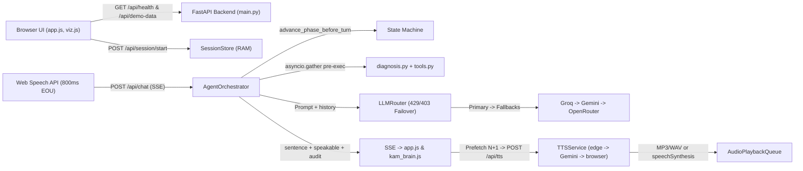

# Snapdeal Virtual KAM ("Riya") — Technical Overview & Handoff

> **Scope & Handoff Note:** Self-contained technical handoff for **Snapdeal Virtual KAM ("Riya")** at `main` commit `8a60ec7`. All claims, file paths, symbol names, and issues reflect direct inspection of repository files (`tests/test_scenarios.py` and `.env` were excluded from reading). Any unverified runtime behavior is marked `ASSUMPTION`.

---

## 1. PROJECT SUMMARY

**Snapdeal Virtual KAM ("Riya")** is a voice-first AI Key Account Manager prototype built for marketplace seller retention and revenue-recovery coaching.

- **Who it is for:** Small Snapdeal marketplace sellers (modeled around seeded persona **Rajesh Kumar** of **Kumar Home & Kitchen**, Delhi) and reviewers/interviewers assessing the **Snapdeal AI First Intern** prototype.
- **Problem it solves:** Passive support bots only answer FAQs. When a seller suffers a sudden **32.5% monthly GMV drop** (`₹2,00,000 -> ₹1,35,000` across `60` SKUs), Riya leads a structured phone consultation: she proves Average Selling Price (`ASP`) stayed flat at `₹500` (volume problem, not price mix), pinpoints root causes (`60%` out-of-stock bestsellers, `20%` competitor pricing gaps, `20%` seller-side cancellations & search-visibility drag), secures dated owner commitments, schedules a 3-day follow-up, and produces a mock WhatsApp recap.
- **Modes & Languages:** Supports `inbound`, `proactive`, and `followup` (`+3 days` partial-recovery simulation) call modes across `en-IN` (Indian English), `hinglish`, and `hi-IN` (Hindi), with `Space`/button and Headphones barge-in plus a live **KAM Brain** verification panel.
- **Current status:** **Working, live-deployed prototype** at `https://snapdeal-virtual-kam.onrender.com/` (Render Free Web Service) and runnable locally with Cloudflare Quick Tunnel. Uses 100% synthetic mock fixtures and zero-cost APIs. Recent commit `8a60ec7` applied the "Spanish Moon Moth" dark theme to the redesigned frontend and passed browser and Render smoke verification.

---

## 2. TECH STACK

| Layer | Technology / Service | Version / Spec | Notes |
| :--- | :--- | :--- | :--- |
| **Backend Language** | Python | `3.12.13` (local `.venv`), `3.12.7` (`render.yaml`) | `requires-python >= 3.11` |
| **Web / ASGI** | FastAPI + Starlette + Uvicorn | `fastapi 0.162.2`, `starlette 1.10.0`, `uvicorn 0.54.0` | Single-worker (`--workers 1`), SSE via `StreamingResponse` |
| **Config & Validation** | Pydantic + pydantic-settings + python-dotenv | `pydantic 2.14.3`, `pydantic-settings 2.16.2`, `python-dotenv 1.2.4` | Cached `Settings` loaded from env / `.env` |
| **HTTP & Uploads** | httpx + python-multipart | `httpx 0.28.1`, `python-multipart 0.0.33` | Async OpenAI-compat SSE streaming & `/api/stt` upload |
| **Primary LLM** | Groq Free Tier (`/chat/completions`) | `openai/gpt-oss-20b` -> `openai/gpt-oss-120b` -> `qwen/qwen3.6-27b` -> `qwen/qwen3.8-27b` | Live `/models` discovery filters retired models at boot |
| **Fallback LLMs** | Gemini Free Tier (`google-genai`) & OpenRouter Free | `google-genai 3.0.0`; `gemini-3.5-flash-lite` -> `gemini-3.6-flash`; `openrouter/free` | Plus deterministic `MockLLMProvider` for automated tests |
| **Voice Input (STT)** | Web Speech API + Groq Whisper | Chrome/Edge `SpeechRecognition` (`en-IN`/`hi-IN`), `whisper-large-v3-turbo` | `/api/stt` backend ready; frontend currently uses `#debugBox` fallback |
| **Voice Output (TTS)** | `edge-tts` -> Gemini TTS -> Browser `speechSynthesis` | `edge-tts 7.3.1`, `gemini-3.8-flash-tts` / `gemini-2.5-flash-preview-tts`, Web Speech | Bounded 200-item LRU cache; HTTP `200` JSON signal for browser fallback |
| **Frontend** | Vanilla HTML / CSS / ES Modules | Zero build step, `Geist` / `Geist Mono`, Web Audio `AnalyserNode` | Served directly by FastAPI (`/` & `/static/*`) |
| **Database / Storage** | None (RAM + Python module fixtures) | `dict` (`SessionStore`), `OrderedDict` (`TTSService`), `seed_data.py` | Ephemeral; resets on Render sleep/restart |
| **Hosting / Tunneling** | Render Free + Docker + Cloudflare Quick Tunnel | `render.yaml` (Singapore free plan, 512 MB RAM), `python:3.12-slim` | `run.ps1` / `run.sh` wrap local server + `cloudflared` HTTPS |
| **Testing** | Pytest + Playwright (`chrome` channel) | `pytest 9.2.0`, `pytest-asyncio 1.4.1.post1`, `playwright 1.65.0` | Unit, reconciliation, contract, failover, and headless Chrome E2E |

---

## 3. FOLDER STRUCTURE

*(Skips `.venv/`, `.git/`, `__pycache__/`, `.pytest_cache/`, `scratch/`, `frontend_old_backup/`, `*.egg-info/`, and `__init__.py` markers.)*

```text
snapdeal/
├── app/
│   ├── config.py                     # Pydantic Settings schema (.env loader & model lists)
│   ├── main.py                       # FastAPI create_app(), lifespan warmups, static mount, REST & SSE routes
│   ├── agent/
│   │   ├── session.py                # Phase enum, SessionState dataclass, in-memory SessionStore
│   │   ├── state_machine.py          # Server-controlled phase transitions, tool gating, <400-tok prompts
│   │   ├── orchestrator.py           # Turn runner: concurrent pre-exec tools, SSE chunking, grounding check
│   │   └── speakable.py              # Markdown/reasoning strip, INR/percent speech normalizer, number auditor
│   ├── data/
│   │   └── seed_data.py              # Synthetic 60-SKU catalog, cancellations, funnel, 3-day followup fixture
│   ├── engine/
│   │   ├── diagnosis.py              # Pure Python KPI math, 60/20/20 attribution, recovery action plan
│   │   └── tools.py                  # OpenAI tool schemas & execute_tool() dispatcher for 11 KAM tools
│   ├── llm/
│   │   ├── base.py                   # CanonicalMessage, ToolCallRequest, LLMStreamChunk, LLMProvider ABC
│   │   ├── openai_compat.py          # Async SSE OpenAI-compat client & streaming ThinkTagFilter
│   │   ├── groq_provider.py          # Groq provider wrapper & startup GET /models filter
│   │   ├── openrouter_provider.py    # Optional OpenRouter :free provider wrapper
│   │   ├── gemini_provider.py        # Gemini streaming adapter w/ thought_signature preservation & folding
│   │   ├── mock_provider.py          # Deterministic rule-based test LLM (ALLOW_MOCK_LLM)
│   │   └── router.py                 # LLMRouter: boot smoke probes, 429 cooldown, 403 permanent disablement
│   └── tts/
│       └── service.py                # 3-tier TTSService (edge-tts -> Gemini TTS -> browser) & LRU cache
├── frontend/
│   ├── index.html                    # Two-column layout: voice stage/transcript/settings + KAM Brain
│   ├── styles.css                    # Spanish Moon Moth CSS tokens, glass panels, responsive rules
│   ├── app.js                        # Call lifecycle, Web Speech STT (800ms EOU), SSE reader, barge-in
│   ├── audio.js                      # AudioPlaybackQueue, 600ms filler, N+1 prefetch, Web Audio tap
│   ├── kam_brain.js                  # Live account table, attribution bar, tool trail, WhatsApp summary
│   └── viz.js                        # 84-bar spectrum canvas using TTS & mic AnalyserNodes
├── scripts/
│   └── smoke_test.py                 # CLI 5-step deployment verifier (/health, /tts-probe, /tts, /demo-data, /chat)
├── tests/
│   ├── test_reconciliation.py        # Verifies 60 SKUs sum to exact headline KPIs & funnel metrics
│   ├── test_diagnosis.py             # Tests attribution percentages, OOS sorting, pricing gaps, 11 tools
│   ├── test_llm_failover.py          # Tests 429 cooldown, mid-call switch, pre-exec, ThinkTagFilter, grounding
│   ├── test_tts_and_api.py           # Tests TTS cache/fallback & full FastAPI SSE session lifecycle
│   ├── test_api_contract.py          # Locks v1 REST/SSE schemas, 403 disablement, sanitized error events
│   ├── test_scenarios.py             # Scenario test suite (excluded from reading during handoff)
│   ├── test_walking_skeleton_ui.py   # Playwright Chrome smoke test (stubbed mic + live server)
│   └── test_full_ui.py               # Playwright E2E test (proactive flow, KAM Brain, summary, followup)
├── docs/                             # API_CONTRACT.md, ASSUMPTIONS.md, DEMO_SCRIPT.md, NOTE.md, captures/*.json
├── .env.example                      # Safe env var template
├── .gitignore / .dockerignore        # Ignore rules (.gitignore includes tests/, .env, cloudflared.exe, scratch/)
├── Dockerfile / render.yaml / Makefile
├── pyproject.toml / requirements.txt
├── run.ps1 / run.sh                  # Local uvicorn + optional Cloudflare Quick Tunnel launchers
├── README.md                         # Setup, architecture, Render deployment & limits guide
└── files.zip / newfrontend.zip / cloudflared.exe  # Legacy zips (files.zip tracked) + gitignored tunnel binary
```

---

## 4. ARCHITECTURE AND FLOW



### End-to-End Request & Voice Flows

1. **Startup & Page Hydration (`create_app` -> `init`):**
   - Server lifespan runs `LLMRouter.initialize_and_smoke_test()` (filters Groq models via `/models` and runs 1 tool smoke call per provider family), `TTSService.startup_smoke_test()`, and warms the TTS cache for 2 phrases.
   - Browser `init()` fetches `GET /api/health` and `GET /api/demo-data` in parallel, hydrating the baseline KPI table in `kam_brain.js` with Diagnosis and Action Plan cards locked.

2. **Call Start & Greeting (`startCall` -> `/api/session/start` + `/greeting`):**
   - User click unlocks Web Audio via `queue.playRingtone()`. `POST /api/session/start` creates a 12-hex-char `SessionState` in `SessionStore`; in `followup` mode it copies `prior_session_id` commitments as `partially_done` or loads `FOLLOWUP_SNAPSHOT["default_prior_commitments"]`.
   - `POST /api/session/{id}/greeting`: `inbound` emits a zero-LLM localized greeting template; `proactive` and `followup` pre-execute `get_seller_overview` + `get_metric_comparison` (`source="server_preexec"`) and stream an LLM opening.

3. **Conversational Turn (`listen` -> `POST /api/chat` -> `AudioPlaybackQueue`):**
   - Chrome `SpeechRecognition` sets a `6000ms` reprompt silence timer and finalizes speech after `800ms` quiet (`S.eou`) -> `say(text)`.
   - `say()` schedules a `600ms` latency filler (`speechSynthesis`) and POSTs to `/api/chat`.
   - `AgentOrchestrator.run_turn()`:
     1. Appends user `CanonicalMessage`, runs deterministic `advance_phase_before_turn()`, emits `phase` and `phase_change`.
     2. In `DIAGNOSE` (5 tools), `REVIEW_COMMITMENTS` (4 tools), and `RECOMMEND` (1 tool), runs `_pre_execute_for_phase()` concurrently (`asyncio.gather`), records grounded numbers into `session.grounded_numbers`, emits `tool_start`/`tool_call`/`tool_result` SSE before tokens, and passes `[]` tools to the LLM (1 LLM request total).
     3. Passes `<400`-token system prompt + `session.messages[-10:]` + phase-gated tools (`<=2` tools in `CLARIFY`/`COMMIT`/`SUMMARY`) to `LLMRouter.stream_turn_with_failover()`.
     4. Streams `token` chunks, extracts complete clauses on `_SENTENCE_BOUNDARY_RE` without breaking decimals (`32.5%`), applies `to_speakable_text()`, and emits `sentence` events.
     5. Executes LLM `tool_calls` (max `MAX_TOOL_ROUNDS = 2`), guarantees a `summary_card` in `SUMMARY`, clips length (`enforce_voice_length`), audits numbers (`find_ungrounded_numbers`), advances counters, and emits `latency` + `done`.
   - Frontend `AudioPlaybackQueue` prefetches sentence `N+1` via `POST /api/tts` while playing sentence `N`, feeding Web Audio `AnalyserNode` -> `viz.js` (or falling back cleanly on HTTP `200` JSON to `window.speechSynthesis`).

4. **Barge-In & Mid-Call Failover:**
   - `Space`, **Interrupt**, or Headphones voice onset calls `interrupt()`: (1) `queue.stopAll()`, (2) `AbortController.abort()` on SSE, (3) restart `listen()`.
   - On upstream `429` (`cooldown`), `403` (`disabled_providers`), timeout, or `5xx` prior to token emission, `LLMRouter` fails over and emits sanitized `failover` SSE `{type, from, to, reason_code}`.

---

## 5. KEY CODE

### 5.1 `app/config.py` (61 lines — full file)
**Does:** Loads env vars / `.env` into cached Pydantic `Settings`. **Depends on:** `functools`, `pydantic_settings`.

```python
"""Application configuration loaded from environment variables / .env."""

from __future__ import annotations

from functools import lru_cache
from pydantic_settings import BaseSettings, SettingsConfigDict


class Settings(BaseSettings):
    model_config = SettingsConfigDict(
        env_file=".env",
        env_file_encoding="utf-8",
        extra="ignore",
    )

    # Primary LLM: Groq Free Tier (ordered chain, filtered live via /models at startup)
    groq_api_key: str = ""
    groq_models: str = "openai/gpt-oss-20b,openai/gpt-oss-120b,qwen/qwen3.6-27b,qwen/qwen3.8-27b"
    groq_reasoning_effort: str = "low"

    # Fallback 1 LLM: Google Gemini Free Tier (excludes gemini-3.8-flash ~20 RPD cap)
    gemini_api_key: str = ""
    gemini_models: str = "gemini-3.5-flash-lite,gemini-3.6-flash"

    # Fallback 2 LLM: OpenRouter Free Tier (optional)
    openrouter_api_key: str = ""
    openrouter_model: str = "openrouter/free"

    # Rate limit / 429 cooldown
    provider_cooldown_seconds: int = 60

    # STT Fallback: Groq Whisper
    groq_whisper_model: str = "whisper-large-v3-turbo"

    # TTS Settings: auto | edge-tts | gemini-tts | browser
    tts_provider: str = "auto"
    tts_voice_en: str = "en-IN-NeerjaNeural"
    tts_voice_hi: str = "hi-IN-SwaraNeural"
    gemini_tts_models: str = "gemini-3.8-flash-tts,gemini-2.5-flash-preview-tts"
    gemini_tts_voice: str = "Aoede"
    tts_cache_enabled: bool = True

    # Server & Runtime
    port: int = 7860
    llm_timeout_seconds: float = 12.0
    enable_gemini_live: bool = False
    allow_mock_llm: bool = False

    def groq_model_list(self) -> list[str]:
        return [m.strip() for m in self.groq_models.split(",") if m.strip()]

    def gemini_model_list(self) -> list[str]:
        return [m.strip() for m in self.gemini_models.split(",") if m.strip()]

    def gemini_tts_model_list(self) -> list[str]:
        return [m.strip() for m in self.gemini_tts_models.split(",") if m.strip()]


@lru_cache(maxsize=1)
def get_settings() -> Settings:
    return Settings()
```

### 5.2 `app/agent/state_machine.py` (220 lines — core logic)
**Does:** Controls conversation phases (`Phase`), phase-gated tools, and compact voice system prompts. **Depends on:** `app.agent.session`, `app.engine.tools.TOOL_SCHEMAS`.

```python
_DIAGNOSIS_REQUEST_SIGNALS = (
    "why", "reason", "cause", "dropped", "drop", "declined", "happened",
    "check", "data", "numbers", "tell me", "what's wrong", "kya hua", "kyu",
)
_BUY_IN_SIGNALS = (
    "yes", "yeah", "yep", "sure", "okay", "ok", "haan", "theek", "kar", "let's do",
    "makes sense", "what should i do", "next", "action", "fix", "recommend", "plan",
)
_COMMIT_SIGNALS = (  # Defined on lines 20-23, currently unreferenced anywhere
    "commit", "promise", "i will", "will do", "friday", "monday", "tuesday",
    "tomorrow", "kal", "48 hours", "today", "aaj", "days", "agree", "done", "yes", "haan", "ok",
)

def advance_phase_before_turn(session: SessionState, user_text: str) -> Phase:
    low = user_text.lower()
    p = session.phase
    if p == Phase.GREETING:
        if session.mode == "followup":
            session.phase = Phase.REVIEW_COMMITMENTS
        elif session.mode == "proactive":
            session.phase = Phase.DIAGNOSE if any(k in low for k in ("why", "what happened", "tell me", "kyu", "kya")) else Phase.CLARIFY
        else:
            session.phase = Phase.CLARIFY if (len(low.split()) >= 6 and any(k in low for k in _DIAGNOSIS_REQUEST_SIGNALS)) else Phase.UNDERSTAND
        return session.phase
    if p == Phase.UNDERSTAND:
        session.phase = Phase.CLARIFY
    elif p == Phase.CLARIFY:
        if (
            session.clarify_questions_asked >= 3
            or (session.clarify_questions_asked >= 2 and any(k in low for k in _DIAGNOSIS_REQUEST_SIGNALS))
            or any(k in low for k in ("check my data", "show me", "tell me why", "you check", "aap check"))
        ):
            session.phase = Phase.DIAGNOSE
    elif p in (Phase.REVIEW_COMMITMENTS, Phase.DIAGNOSE):
        session.phase = Phase.RECOMMEND
    elif p == Phase.RECOMMEND and (session.recommend_turns >= 1 or any(k in low for k in _BUY_IN_SIGNALS)):
        session.phase = Phase.COMMIT
    elif p == Phase.COMMIT and (session.commitments or session.commit_turns >= 2):
        session.phase = Phase.SUMMARY
    elif p == Phase.SUMMARY:
        session.phase = Phase.CLOSE
    return session.phase
```

### 5.3 `app/agent/orchestrator.py` (447 lines — pre-exec & turn streaming)
**Does:** Executes concurrent pre-phase tools, builds windowed prompt/history, runs up to `2` tool-calling rounds over `LLMRouter`, streams tokens/sentences, and audits numbers. **Depends on:** `LLMRouter`, `state_machine`, `speakable`, `engine.tools`.

```python
_SENTENCE_BOUNDARY_RE = re.compile(r"(.+?(?:[?!\u0964]|(?<!\d)\.(?!\d)|\.(?=\s)))(?:\s+|$)", re.DOTALL)

async def _run_pre_tools(self, session: SessionState, tool_specs: list[tuple[str, dict[str, Any]]]):
    events, combined = [], {}
    async def _exec_one(tname, targs):
        t0 = time.perf_counter()
        res = await asyncio.to_thread(execute_tool, tname, targs, session)
        return tname, targs, res, round((time.perf_counter() - t0) * 1000, 2)
    for tname, targs in tool_specs:
        payload = {"name": tname, "arguments": targs, "source": "server_preexec"}
        events.extend([_sse("tool_start", payload), _sse("tool_call", payload)])
    for tname, targs, res, ms in await asyncio.gather(*[_exec_one(n, a) for n, a in tool_specs]):
        session.grounded_numbers.update(extract_numbers_from_obj(res))
        session.tool_history.append({"name": tname, "arguments": targs, "result": res, "latency_ms": ms, "source": "server_preexec"})
        combined[tname] = _compact_tool_payload(tname, res)
        events.append(_sse("tool_result", {"name": tname, "result": res, "latency_ms": ms, "source": "server_preexec"}))
    return combined, events
```
In `_stream_agent_response()`: slices `recent_history = session.messages[-10:]`, guarantees `send_call_summary` in `SUMMARY` via `"server_fallback"`, enforces 45/75-word cap (`enforce_voice_length`), and runs `find_ungrounded_numbers(cleaned_reply, session.grounded_numbers)`.

### 5.4 `app/llm/router.py` (249 lines — smoke probes & failover)
**Does:** Orders candidates, skips cooling (`429`) or permanently disabled (`403`) endpoints, and emits sanitized failover events. **Depends on:** `GroqProvider`, `GeminiProvider`, `OpenRouterProvider`, `MockLLMProvider`.

```python
def _ordered_candidates(self) -> list[LLMProvider]:
    active = [p for p in self.configured_providers() if not self.is_disabled(p.key)]
    if not active:
        return []
    now = time.monotonic()
    ready = [p for p in active if not self.is_in_cooldown(p.key, now)]
    cooling = sorted([p for p in active if self.is_in_cooldown(p.key, now)], key=lambda p: self.cooldowns.get(p.key, 0.0))
    return ready if ready else cooling

async def stream_turn_with_failover(self, messages, tools, temperature=0.25, max_tokens=220):
    candidates = self._ordered_candidates()
    failovers, sanitized_errors = [], []
    for idx, provider in enumerate(candidates):
        emitted = False
        try:
            async for chunk in provider.stream_turn(messages, tools, temperature, max_tokens):
                if chunk.type in ("token", "tool_calls"):
                    emitted = True
                yield chunk, failovers
            return
        except ProviderRateLimitOrTransientError as exc:
            sanitized_errors.append(f"{provider.key} ({exc.reason_code})")
            if exc.is_forbidden:
                self.mark_disabled(provider.key, reason=exc.reason_code)
            elif exc.is_rate_limit:
                self.mark_cooldown(provider.key, exc.retry_after_seconds)
            if emitted:
                raise
            if idx + 1 < len(candidates):
                failovers.append({"type": "provider_failover", "from": provider.key, "to": candidates[idx + 1].key, "reason_code": exc.reason_code})
    raise AllProvidersUnavailableError("All configured LLM providers failed: " + " | ".join(sanitized_errors))
```

### 5.5 `app/llm/gemini_provider.py` (258 lines — canonical conversion)
**Does:** Streams via `google-genai` SDK (`MINIMAL` thinking, `max_output_tokens >= 900`), preserves `thought_signature`, and folds unsigned cross-provider tool histories into plain text. **Depends on:** `google.genai`, `app.llm.base`.

```python
if has_tool_calls and not has_gemini_sig:
    # Prevents 400 INVALID_ARGUMENT when failing over mid-call from Groq/OpenRouter into Gemini 3.x
    summary_bits = [msg.content] if msg.content else []
    for tc in msg.tool_calls:
        call_id_to_name[tc.id] = tc.name
        folded_call_ids.add(tc.id)
        summary_bits.append(f"[Called {tc.name}({json.dumps(tc.arguments, ensure_ascii=False)})]")
    contents.append(types.Content(role="model", parts=[types.Part.from_text(text=" ".join(summary_bits))]))
    continue
```

### 5.6 `app/engine/diagnosis.py` (525 lines — deterministic math)
**Does:** Aggregates `SKU_CATALOG`, `CANCELLATION_BREAKDOWN`, `VISIBILITY_FUNNEL`, and `FOLLOWUP_SNAPSHOT` into exact driver attribution and recovery plans. **Depends on:** `app.data.seed_data`.

```python
def run_diagnosis(snapshot: SnapshotType = "current") -> dict[str, Any]:
    headline = compute_headline_metrics(snapshot)
    oos = get_out_of_stock_skus(limit=5, snapshot=snapshot)
    pricing = get_pricing_gaps(snapshot=snapshot)
    funnel = get_visibility_funnel(snapshot=snapshot)
    total_lost_orders = abs(headline["metrics"]["orders"]["delta"])     # 130
    total_lost_rev = abs(headline["metrics"]["sales_gmv"]["delta"])     # 65000
    vis_sla_lost_orders = sum(max(0, s.last_month_orders - s.this_month_orders) for s in SKU_CATALOG if s.driver_group == "visibility_sla")
    # Builds 3 ranked drivers: 60.0% stock_outs (78 orders), 20.0% pricing_gaps (26), 20.0% cancellations_visibility (26)
```
*(Note: In `get_out_of_stock_skus("followup")` lines 184–192, `total_oos_count` reads `9` while `newly_oos_count=9`, `chronic_oos_count=5`, and `total_oos_lost_orders=78` still reflect baseline pre-restock values.)*

### 5.7 `app/tts/service.py` (269 lines — 3-tier TTS & LRU cache)
**Does:** Synthesizes `edge-tts` MP3 -> Gemini WAV (wrapping raw PCM) -> `{"fallback": "browser"}` with 200-entry `OrderedDict` cache. **Depends on:** `edge_tts`, `google.genai`, `app.config.Settings`.

```python
async def synthesize(self, text: str, language: str = "en-IN", provider_override: str | None = None):
    clean_text = text.strip()
    pref = (provider_override or self.settings.tts_provider or "auto").lower()
    voice = self.voice_for_language(language)  # hi-IN -> hi-IN-SwaraNeural | else en-IN-NeerjaNeural
    if not clean_text or pref == "browser":
        return None, {"fallback": "browser", "reason": "empty_text" if not clean_text else "user_selected_browser", "cached": False}
    cache_key = (pref, voice, clean_text)
    if (cached := self._get_cached(cache_key)) is not None:
        return cached, {"provider": cached.provider, "voice": cached.voice, "cached": True}
    # 1. Try edge-tts (sets 30s cooldown on exception) -> 2. Try Gemini TTS if smoke-ok -> 3. Return None for browser speechSynthesis
```

### 5.8 `app/main.py` (312 lines — API routes & lifespan)
**Does:** Wires `SessionStore`, `LLMRouter`, `TTSService`, `AgentOrchestrator`, CORS `*`, static assets, REST endpoints, and SSE streams. **Depends on:** `fastapi`, `httpx`, `app.*`.

```python
@app.post("/api/session/start")
async def start_session(req: StartSessionRequest) -> dict[str, Any]:
    session = store.create(mode=req.mode, language=req.language, prior_session_id=req.prior_session_id)
    return {"session_id": session.session_id, "session": session.to_public_dict(), "demo_data": await demo_data(snapshot=session.snapshot)}

@app.post("/api/tts")
async def synthesize_tts(req: TTSRequest):
    audio, meta = await tts_service.synthesize(text=req.text, language=req.language, provider_override=req.provider)
    if audio is None:
        return JSONResponse({"use_browser_tts": True, **meta}, status_code=200)
    return Response(content=audio.audio_bytes, media_type=audio.media_type, headers={"X-TTS-Provider": audio.provider, "X-TTS-Voice": audio.voice, "X-TTS-Cached": "true" if meta.get("cached") else "false"})
```
Also exposes `GET /`, `/api/health`, `/api/demo-data`, `/api/tts-probe`, `/api/session/{id}`, `POST /api/session/{id}/greeting`, `/api/chat`, `/api/session/{id}/settings`, and `/api/stt` (Groq Whisper fallback).

### 5.9 `frontend/audio.js` (64 lines — full file)
**Does:** Manages sentence-queued playback, `600ms` latency filler, N+1 `/api/tts` prefetch, Web Audio `AnalyserNode` tap, and barge-in `stopAll()`. **Depends on:** Browser `AudioContext`, `speechSynthesis`, `fetch("/api/tts")`.

```javascript
const FILLER={"hi-IN":"जी, एक सेकंड, मैं आपका डेटा देख रही हूँ।",hinglish:"Ji, ek second, main aapka data dekh rahi hoon.","en-IN":"One moment Rajesh ji, checking your account data."};
const synth=()=>("speechSynthesis" in window?window.speechSynthesis:null);
export class AudioPlaybackQueue{
  constructor(cb={}){this.cb=cb;this.queue=[];this.isPlaying=false;this.aborted=false;this.language="en-IN";this.ttsProvider="auto";this.fillerTimer=null;this.fillerOn=false;this.ctrls=new Set();this.gen=0;this.resolveCur=null;this.audio=null;this.ctx=null;this.an=null;this.src=null}
  configure({language,ttsProvider}){if(language)this.language=language;if(ttsProvider)this.ttsProvider=ttsProvider}
  ensureCtx(){try{if(!this.ctx){const C=window.AudioContext||window.webkitAudioContext;if(!C)return;this.ctx=new C();this.an=this.ctx.createAnalyser();this.an.fftSize=256;this.an.smoothingTimeConstant=.78;this.an.connect(this.ctx.destination)}if(this.ctx.state==="suspended")this.ctx.resume().catch(()=>{})}catch{}}
  tap(a){try{this.ensureCtx();if(!this.ctx||this.ctx.state!=="running")return;this.src=this.ctx.createMediaElementSource(a);this.src.connect(this.an)}catch{this.src=null}}   // if the context is not running, audio plays untapped
  analyser(){return this.src?this.an:null}   // null while browser TTS speaks, the visualizer then simulates
  playRingtone(){this.ensureCtx();try{const c=new(window.AudioContext||window.webkitAudioContext)(),t=c.currentTime;for(let i=0;i<2;i++){const o=c.createOscillator(),g=c.createGain(),s=t+i*.35;o.frequency.value=440;g.gain.setValueAtTime(.0001,s);g.gain.exponentialRampToValueAtTime(.06,s+.03);g.gain.exponentialRampToValueAtTime(.0001,s+.25);o.connect(g);g.connect(c.destination);o.start(s);o.stop(s+.26)}setTimeout(()=>c.close().catch(()=>{}),900)}catch{}}
  scheduleLatencyFiller(ms=600){this.clearLatencyFiller();this.fillerTimer=setTimeout(()=>{if(this.isPlaying||this.queue.length)return;this.fillerOn=true;this.speak(FILLER[this.language]||FILLER["en-IN"],true).finally(()=>{this.fillerOn=false})},ms)}
  clearLatencyFiller(){clearTimeout(this.fillerTimer);this.fillerTimer=null}
  enqueueSentence(text,onFirst){
    const t=(text||"").trim();if(!t)return;
    this.clearLatencyFiller();
    if(this.fillerOn){synth()?.cancel();this.fillerOn=false}   // fix: filler never talks over the first server sentence
    this.aborted=false;
    const c=new AbortController();this.ctrls.add(c);
    const p=this.fetchTts(t,c.signal).finally(()=>this.ctrls.delete(c));  // prefetch N+1 while N plays
    this.queue.push({text:t,p,onFirst});
    if(!this.isPlaying)this.drain();
  }
  async fetchTts(text,signal){
    if(this.ttsProvider==="browser")return{browser:true,provider:"browser"};
    try{
      const r=await fetch("/api/tts",{method:"POST",headers:{"Content-Type":"application/json"},body:JSON.stringify({text,language:this.language,provider:this.ttsProvider}),signal});
      if(!r.ok||(r.headers.get("content-type")||"").includes("application/json"))return{browser:true,provider:"browser"};   // 200 + JSON = use browser voice
      return{blob:await r.blob(),provider:r.headers.get("X-TTS-Provider")||"edge-tts"};
    }catch{return{browser:true,provider:"browser"}}
  }
  async drain(){
    if(this.isPlaying)return;
    const g=++this.gen;this.isPlaying=true;this.cb.onSpeakingStart?.();
    while(this.queue.length&&!this.aborted&&g===this.gen){
      const it=this.queue.shift(),r=await it.p;
      if(this.aborted||g!==this.gen)break;
      it.onFirst?.();this.cb.onTtsProviderUsed?.(r.provider);
      await(r.browser?this.speak(it.text):this.play(r.blob));
    }
    if(g===this.gen){this.isPlaying=false;this.cb.onSpeakingEnd?.()}
  }
  play(blob){return new Promise(res=>{
    if(this.aborted)return res();
    const u=URL.createObjectURL(blob),a=new Audio(u);this.audio=a;let d=false;this.tap(a);
    const done=()=>{if(d)return;d=true;if(this.resolveCur===done)this.resolveCur=null;if(this.audio===a)this.audio=null;URL.revokeObjectURL(u);if(this.src){try{this.src.disconnect()}catch{}this.src=null}res()};
    this.resolveCur=done;a.onended=done;a.onerror=done;a.play().catch(done);
  })}
  speak(text,filler=false){return new Promise(res=>{
    const s=synth();if(!s||(this.aborted&&!filler))return res();
    let d=false;const done=()=>{if(d)return;d=true;if(!filler&&this.resolveCur===done)this.resolveCur=null;res()};
    try{
      s.cancel();const u=new SpeechSynthesisUtterance(text);u.lang=this.language==="hi-IN"?"hi-IN":"en-IN";u.rate=1.03;
      const v=s.getVoices(),m=v.find(x=>x.lang.toLowerCase().includes(u.lang.toLowerCase()))||v.find(x=>x.lang.toLowerCase().startsWith("en-in"));if(m)u.voice=m;
      if(!filler)this.resolveCur=done;u.onend=done;u.onerror=done;s.speak(u);
    }catch{done()}
  })}
  stopAll(){   // invariant: call this before aborting the chat stream or restarting the mic
    this.clearLatencyFiller();this.gen++;this.aborted=true;this.queue=[];
    this.ctrls.forEach(c=>c.abort());this.ctrls.clear();
    if(this.audio){try{this.audio.pause();this.audio.currentTime=0}catch{}this.audio=null}
    if(this.resolveCur){const f=this.resolveCur;this.resolveCur=null;f()}
    try{synth()?.cancel()}catch{}
    this.fillerOn=false;this.isPlaying=false;
  }
}
```

### 5.10 `frontend/app.js` (176 lines) & `frontend/kam_brain.js` (99 lines)
**Do:** `app.js` binds Web Speech STT, SSE parsing, and DOM controls; `kam_brain.js` renders metrics, root-cause bar, OOS/pricing lists, commitments, tool trace, and mock WhatsApp summary. **Depend on:** `/static/audio.js`, `/static/viz.js`, backend REST/SSE routes.

```javascript
// app.js (lines 71-74 & 108-116)
export function interrupt(){   // order matters: audio first, then stream, then mic
  if(!S.inCall)return;
  queue.stopAll();if(S.abort){S.abort.abort();S.abort=null}listen();
}
export async function say(text){
  const t=(text||"").trim();if(!t)return;
  if(!S.inCall||!S.sessionId)await startCall();  // auto-starts greeting stream before sending chat turn
  el.errorBanner.classList.add("hidden");queue.stopAll();S.reprompted=false;S.sttEnd=performance.now();
  ...
  await stream("/api/chat",{session_id:S.sessionId,text:t,language:S.language});
}

// kam_brain.js (line 47 — BUG: repriced_skus elements are objects {sku_id, ...}, not strings)
const o=(b.oos?.top_oos_skus||[]).slice(0,4),p=(b.price?.pricing_gaps||[]).filter(x=>!(b.price.repriced_skus||[]).includes(x.sku_id));
```

---

## 6. DATA MODEL

No database exists (`SQLite`/`Postgres`/`Redis` absent). Store fixtures are static Python constants; session state lives purely in RAM.

- **Seed Catalog (`app/data/seed_data.py`):**
  - `SELLER_PROFILE`: `seller_id="MOCK-DL-4821"`, `seller_name="Rajesh Kumar"`, `shop_name="Kumar Home & Kitchen"`, `city="Delhi"`, `active_catalog_size=60`.
  - `SkuRecord` (`frozen=True`): `sku_id` (`HK-001`..`HK-060`), `name`, `category`, `price`, `competitor_lowest_price`, `last_month_orders`, `this_month_orders`, `last_month_oos`, `this_month_oos`, `days_oos_this_month`, `stock_qty`, `driver_group` (`chronic_oos` [5] | `newly_oos_top` [5] | `newly_oos_tail` [8] | `overpriced` [3] | `visibility_sla` [13] | `stable` [26]). Totals: `400 -> 270` orders (`-130`), `₹2,00,000 -> ₹1,35,000` (`-32.5%`), ASP `₹500 -> ₹500`, lost orders = `78 + 26 + 26 = 130` (`60% / 20% / 20%`).
  - `CANCELLATION_BREAKDOWN`: `32/400 (8.0%)` -> `38/270 (14.0%)` (seller stock `6 -> 14`, dispatch SLA `5 -> 9`, buyer `15 -> 11`, courier `6 -> 4`).
  - `VISIBILITY_FUNNEL`: `80,000 -> 68,800` impressions (`-14.0%`), clicks `3,200 -> 2,477`, orders `400 -> 270`.
  - `FOLLOWUP_SNAPSHOT`: Simulated `+3 days` state (`₹1,75,500` pace, `351` orders, `9` OOS, `10.5%` cancels), `restocked_top_skus` (4 strings), `remaining_oos_priority_sku` (`HK-009`), `repriced_skus` (2 dicts: `HK-019`, `HK-020`), `remaining_overpriced_sku` (`HK-021`), `default_prior_commitments`, `targets` (`OOS <= 8`, `Cancels <= 10.0%`).
- **Runtime State (`app/agent/session.py`, `app/llm/base.py`, `app/tts/service.py`):**
  - `SessionState`: 12-char hex `session_id`, `mode`, `snapshot`, `language`, `phase`, turn counters, `diagnose_preloaded`/`recommend_preloaded`, `messages: list[CanonicalMessage]`, `tool_history`, `grounded_numbers: set[float]`, `commitments`, `prior_commitments`, `followup_schedule`, `summary_card`, `active_provider`, `failover_events`, `latency_history`, `ungrounded_warnings`.
  - `CanonicalMessage` / `ToolCallRequest`: `role` (`system|user|assistant|tool`), `content`, `tool_calls`, `tool_call_id`, `tool_name`, `extra_metadata["gemini_thought_signature"]`.
  - `CachedAudio`: `(audio_bytes, media_type, provider, voice)` in 200-entry `OrderedDict`.
- **SSE `v1` Event Contracts (`docs/API_CONTRACT.md`):** `phase`, `phase_change`, `tool_start`, `tool_call`, `tool_result`, `summary_card`, `failover` (`{type, from, to, reason_code}`), `token`, `sentence` (`{text, speakable}`), `latency`, `done`, `error`.

---

## 7. SETUP AND COMMANDS

```powershell
# 1. Create venv & install runtime deps (Windows PowerShell)
python -m venv .venv
.\.venv\Scripts\activate
pip install -r requirements.txt

# Optional dev/UI test deps:
pip install -e ".[dev]"
playwright install chromium

# 2. Configure keys (copy template; NEVER commit .env)
copy .env.example .env
```

### Environment Variables (`app/config.py` / `.env.example`)
| Variable | Default | Purpose & Placeholder |
| :--- | :--- | :--- |
| `GROQ_API_KEY` | `""` | **Recommended.** Groq free key (`<GROQ_API_KEY_PLACEHOLDER>`). Also powers `/api/stt`. |
| `GROQ_MODELS` | `openai/gpt-oss-20b,openai/gpt-oss-120b,qwen/qwen3.6-27b,qwen/qwen3.8-27b` | Ordered Groq chain, filtered at boot via `/models`. |
| `GROQ_REASONING_EFFORT` | `low` | Reasoning level sent to `gpt-oss` / reasoning models. |
| `GEMINI_API_KEY` | `""` | **Recommended.** Google AI Studio free key (`<GEMINI_API_KEY_PLACEHOLDER>`). Fallback LLM + optional TTS. |
| `GEMINI_MODELS` | `gemini-3.5-flash-lite,gemini-3.6-flash` | Ordered Gemini fallback chain (`3.8-flash` omitted for ~20 RPD free limit). |
| `OPENROUTER_API_KEY` | `""` | Optional 2nd fallback key (`<OPENROUTER_API_KEY_PLACEHOLDER>`). |
| `OPENROUTER_MODEL` | `openrouter/free` | OpenRouter free model slug. |
| `PROVIDER_COOLDOWN_SECONDS` | `60` | `429` cooldown when upstream omits `Retry-After`. |
| `GROQ_WHISPER_MODEL` | `whisper-large-v3-turbo` | Model for `POST /api/stt`. |
| `TTS_PROVIDER` | `auto` | `auto \| edge-tts \| gemini-tts \| browser`. |
| `TTS_VOICE_EN` / `TTS_VOICE_HI` | `en-IN-NeerjaNeural` / `hi-IN-SwaraNeural` | Neural voices per language. |
| `GEMINI_TTS_MODELS` / `GEMINI_TTS_VOICE` | `gemini-3.8-flash-tts,gemini-2.5-flash-preview-tts` / `Aoede` | Emergency Gemini TTS fallback chain & voice. |
| `TTS_CACHE_ENABLED` | `true` | Enables 200-item audio LRU cache. |
| `PORT` / `LLM_TIMEOUT_SECONDS` | `7860` / `12.0` | Server port (Render injects `$PORT`) & per-provider stream timeout. |
| `ENABLE_GEMINI_LIVE` / `allow_mock_llm` | `false` / `false` | Health flag (unimplemented) / enables `MockLLMProvider` (`ALLOW_MOCK_LLM=true`). |

### Run, Build, Test & Deploy
```powershell
# Run locally (+ Cloudflare Quick Tunnel HTTPS if cloudflared is present):
.\run.ps1                 # Windows with tunnel; .\run.ps1 -LocalOnly for HTTP 127.0.0.1:7860
./run.sh                  # macOS/Linux (--local skips tunnel)

# Direct Uvicorn / Makefile:
uvicorn app.main:app --host 127.0.0.1 --port 7860 --workers 1
make run | make tunnel | make smoke | make test

# Docker (single container, matches render.yaml start command style):
docker build -t snapdeal-virtual-kam .
docker run -p 7860:7860 --env-file .env -e PORT=7860 snapdeal-virtual-kam

# Tests (note: walking_skeleton & full_ui hit live LLM/Chrome; deterministic tests run offline):
.\.venv\Scripts\pytest.exe tests/test_diagnosis.py tests/test_reconciliation.py tests/test_llm_failover.py tests/test_tts_and_api.py tests/test_api_contract.py -v
.\.venv\Scripts\pytest.exe -v

# Live deployment smoke test:
.\.venv\Scripts\python.exe scripts/smoke_test.py --url https://snapdeal-virtual-kam.onrender.com

# Deploy: push to main -> Render Blueprint auto-deploys render.yaml (set GROQ_API_KEY + GEMINI_API_KEY in Render env).
```

---

## 8. CONVENTIONS AND DECISIONS

- **Zero-Math LLM & Grounding Audit:** Models never calculate. Deterministic Python (`diagnosis.py`) computes metrics; `orchestrator.py` indexes returned numbers in `grounded_numbers`, then checks replies via `find_ungrounded_numbers()` and surfaces audit badges (`"Every number verified"`).
- **Phase-Gated Tools & Pre-Execution:** Server transitions call stages deterministically and runs all analysis tools concurrently (`asyncio.gather`) before LLM inference in `DIAGNOSE`, `REVIEW_COMMITMENTS`, and `RECOMMEND`, exposing `0` tools to keep turns to **1 LLM call** under free-tier TPM limits.
- **Cross-Provider Gemini Compatibility:** `CanonicalMessage` folds unsigned Groq/OpenRouter tool history to text before sending to Gemini, avoiding Gemini 3.x HTTP `400` missing `thought_signature` errors while preserving Gemini's own signatures natively.
- **Clean Streaming Voice Normalization:** `ThinkTagFilter` strips `<think>` tokens on the fly; `_SENTENCE_BOUNDARY_RE` avoids splitting decimals (`32.5%`); `to_speakable_text()` expands `₹2,00,000` and `SKU/OOS/SLA` for TTS.
- **HTTP 200 JSON Browser-TTS Signal:** Returns `200 {"use_browser_tts": true}` when `edge-tts` / Gemini TTS fail so browsers switch silently to `window.speechSynthesis` without failed network requests.
- **Half-Duplex Default & Spanish Moon Moth UI:** Recognition pauses while Riya speaks (preventing speaker echo) unless **Headphones** mode is toggled; frontend uses zero-build ES modules, `esc()` HTML escaping, `data-completed-streams` test hooks, and earthy dark tokens (`#151416`, `#a37c95`, `#89b093`, `#e5c185`).
- **Single-Worker Constraint:** `--workers 1` is required because `SessionStore`, router cooldowns, and `TTSService` cache reside strictly in process RAM (kept lean for Render's 512 MB limit).

---

## 9. CURRENT STATE

- **Working & Verified:** Complete backend (`FastAPI`, 60-SKU engine, 11 tools, multi-provider cooldown failover, 3-tier TTS) and redesigned vanilla frontend deployed live at `https://snapdeal-virtual-kam.onrender.com/` (`8a60ec7`), passing `scripts/smoke_test.py` (5/5) and offline unit/contract tests (`test_diagnosis.py`, `test_reconciliation.py`, `test_llm_failover.py`, `test_tts_and_api.py`, `test_api_contract.py`).
- **Confirmed Bugs & Discrepancies:**
  1. `frontend/kam_brain.js#L47`: `(b.price.repriced_skus||[]).includes(x.sku_id)` compares object items (`{sku_id: "HK-019", ...}` in `seed_data.py#L308`) against a string ID, so already-repriced SKUs still render under "Priced above competitors" in `followup` mode.
  2. `app/engine/diagnosis.py#L184-L192, L273`: `followup` mode mixes patched headline values (`total_oos_count: 9`, `overpriced_sku_count: 1`) with unadjusted aggregates (`newly_oos_count: 9 + chronic_oos_count: 5 = 14`; `total_pricing_lost_orders: 26` across all 3 SKUs).
  3. `app/agent/state_machine.py#L16-L23, L90`: `_BUY_IN_SIGNALS` checks substrings (`"ok"`, `"yes"`, `"kar"`), causing words like `"look"` or `"broken"` in `RECOMMEND` to misfire into `COMMIT`; `_COMMIT_SIGNALS` is dead unused code.
  4. `app/agent/orchestrator.py#L244`: `session.messages[-10:]` can slice mid-tool-sequence, leaving an orphaned leading `role="tool"` message that triggers HTTP `400` on OpenAI-compat APIs.
- **Half-Done / Unused Code / Fragile Areas:**
  - `POST /api/stt` (`app/main.py#L279-L307`) is unreferenced by `frontend/`; non-Chrome users rely on `#debugBox`.
  - `frontend/styles.css` contains ~65 lines of orphaned CSS from the prior bento design (`.kpi`, `.insight`, `.delta`, `.sku`, `.meter`, `.rank`, `.phone`, `.cmp`, `.sum-grid`); repo root still has `files.zip` (tracked) and `newfrontend.zip` (untracked).
  - `frontend/viz.js#L2, L15-L25, L85`: `USE_MIC = true` opens a parallel `getUserMedia` stream alongside `SpeechRecognition` (potential driver conflict on some setups `ASSUMPTION`), and runs `requestAnimationFrame` unthrottled while idle.
  - `frontend/audio.js#L9` creates a separate throwaway `AudioContext` on every `playRingtone()`.
  - `app/agent/speakable.py#L128-L159` turns `₹` amounts into English words (`"one lakh ... rupaye"`) even for Devanagari `hi-IN` output.
  - Render Free instance is unauthenticated/unthrottled (`CORSMiddleware("*")`, unbounded `SessionStore`, per-request `httpx.AsyncClient` / `genai.Client`, 15-min idle sleep); Playwright tests (`test_walking_skeleton_ui.py`, `test_full_ui.py`) depend on live LLM keys and `tests/` is in `.gitignore`.

---

## 10. WHAT I WANT NEXT

| Rank | Tag | Impact / Effort | Improvement & Files |
| :--- | :--- | :--- | :--- |
| **1** | `[bug]` | **High / Very Low** | **Fix followup SKU filter & state-machine matching:** Use `.some(s => s.sku_id === x.sku_id)` in `frontend/kam_brain.js#L47`; replace raw substring matching in `app/agent/state_machine.py` with `\b...\b` regexes + negation checks and delete dead `_COMMIT_SIGNALS`. |
| **2** | `[bug]` | **High / Low** | **Fix history slice boundary & followup math:** Walk back past orphaned `role="tool"` turns when slicing `session.messages[-10:]` in `app/agent/orchestrator.py#L244`; derive `followup` OOS/pricing metrics consistently from cloned `SkuRecord`s in `app/engine/diagnosis.py`. |
| **3** | `[security]` `[performance]` | **High / Low** | **Protect public quotas & bound RAM:** Add per-IP rate limiting + configurable `CORS` origins in `app/main.py`, and add session TTL + max-entries LRU eviction in `app/agent/session.py`. |
| **4** | `[missing feature]` `[UX]` | **High / Medium** | **Parameterize seller & add catalog upload:** Move seller identity/catalog from hardcoded constants (`app/data/seed_data.py`, `app/engine/tools.py`, `app/agent/state_machine.py`, `app/agent/orchestrator.py`, `frontend/index.html`) into a per-session `SellerContext` with CSV/JSON upload. |
| **5** | `[missing feature]` `[UX]` | **Med-High / Medium** | **Wire `/api/stt` Whisper recording in UI:** Add `MediaRecorder` push-to-talk in `frontend/app.js` when `SpeechRecognition` is unavailable (Firefox, Safari, iOS) so all browsers get voice input. |
| **6** | `[performance]` | **Medium / Low** | **Pool HTTP & Gemini clients:** Reuse shared `httpx.AsyncClient` and `genai.Client` instances across requests in `app/llm/openai_compat.py`, `app/llm/gemini_provider.py`, and `app/tts/service.py`. |
| **7** | `[UX]` | **Medium / Low** | **Fix WCAG contrast, idle GPU burn & AudioContext churn:** Darken `.btn.primary` text/hover gradient in `frontend/styles.css`, reuse `this.ctx` in `frontend/audio.js#L9`, pause `rAF` when idle, and guard `USE_MIC` contention in `frontend/viz.js`. |
| **8** | `[UX]` `[bug]` | **Medium / Low** | **Improve `hi-IN` TTS & localized fallbacks:** Avoid English number-word injection into Devanagari `hi-IN` strings in `app/agent/speakable.py`, and localize empty-reply fallbacks in `app/agent/orchestrator.py#L390-L396`. |
| **9** | `[code quality]` | **Low-Med / Very Low** | **Remove dead CSS & root archives:** Prune unused `.kpi`/`.phone`/`.sku`/`.sum-grid` classes from `frontend/styles.css`, sync `docs/FRONTEND_HANDOFF_*`, and delete legacy `files.zip` / `newfrontend.zip`. |
| **10** | `[code quality]` | **Medium / Low** | **Hermetic UI CI & test tracking:** Add an `ALLOW_MOCK_LLM=true` mode to `tests/test_walking_skeleton_ui.py` and `tests/test_full_ui.py` for offline runs, and clean up `tests/` `.gitignore` policy. |

---

## 11. OPEN QUESTIONS

Before recommending or making changes, ask the user:

1. **Prototype vs. Product Scope:** Should Riya remain a polished single-seller interview demo (*Rajesh Kumar / Kumar Home & Kitchen*), or do you want multi-seller switching and CSV catalog upload?
2. **Persistence & Cost Constraint:** Do we remain strictly zero-cost / stateless on Render Free (`--workers 1`), or are you open to adding a free-tier DB/KV store (e.g., Supabase/Neon/Upstash) so sessions and commitments persist across sleeps?
3. **Public Access Protection:** `https://snapdeal-virtual-kam.onrender.com/` is openly accessible without auth—should we add IP rate limiting or a demo PIN to protect your Groq/Gemini quotas?
4. **Non-Chrome Voice Support:** Is desktop Chrome/Edge good enough for demos, or is mobile Safari / Firefox microphone capture via `/api/stt` important?
5. **Cleanup Decisions:** Should we remove the dead legacy CSS from `frontend/styles.css`, delete `files.zip` / `newfrontend.zip`, and un-ignore `tests/` in `.gitignore`?
